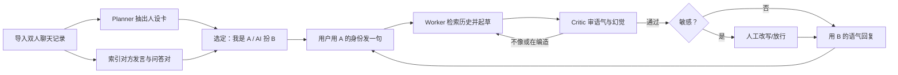
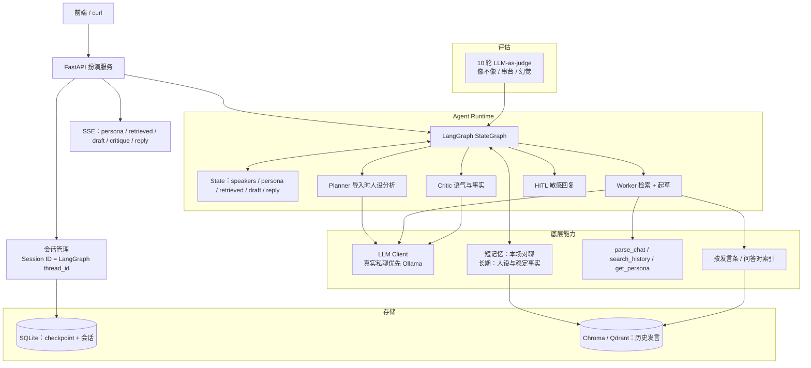
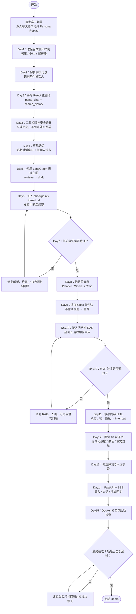
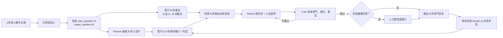

# AI Agent 15天学习配套｜开源项目源码阅读清单 & Demo整合架构
> 适配15天AI Agent学习计划，成熟开发者。
> 阅读原则：不通读全仓库，**只读关键模块文件**；编码优先，源码阅读作为对照参考。
> Demo 只服务 **一个应用场景**：双人聊天语气分身（Persona Replay）。其余模块都围绕这条链路实现，不并行做调研报告、客服工单等第二场景。

## 阅读约定
- 仓库链接均为 `https://github.com/` 完整地址；路径以当前主分支为准，仓库重构后以目录检索为准，不要死磕旧路径。
- 时间窗口：对应15天学习计划的 DayN。
- 阅读模式：只看指定文件，其余跳过；边写自己 Demo 边对照源码。
- 主线编码：LangGraph。CrewAI / AG2 Classic / AgentScope 只对比范式，不引入为运行时依赖。

---

# 零、应用场景：双人聊天语气分身（Persona Replay）

## 锁定的主链路（只做这五步，不改成别的产品）
1. **解析双人私聊**（先不做客群）
2. **你指定「我是 A，AI 扮 B」**
3. **检索 B 历史上怎么回过类似的话**
4. **按人设卡（称呼、句长、口头禅）起草**
5. **Critic 拦住助手腔、串台、以及记录里没有的事**

## 一句话定义
用上面五步，把导入的记录变成「B 的语气接着聊」；模型不能只靠 prompt 装腔，必须先检索再写，写完必须过 Critic。

## 为什么改成这一个
- 你要的就是这个产品形态，15 天只打这一条竖切。
- 技术上仍然覆盖 Agent 主线：解析工具、历史检索（RAG）、人设记忆、Worker 生成、Critic 审语气、HITL、SSE。
- 验收可感知：同一句话，关掉人设是「助手腔」，打开人设能听出是记录里的那个人。

## 产品约定（先定死，避免做成万能角色扮演）
- 只支持 **双人私聊** 导出，不支持群聊（群聊说话人噪声大，15 天做不稳）。
- 导入后必须指定：`user_speaker`（你）、`target_speaker`（AI 要学的人）。
- AI **只扮演 target**，不替双方各说各话。
- 回复优先级：对方真实历史说法 > 人设卡（口头禅、句长、称呼）> 模型自由发挥。
- 历史里没有的事件、承诺、隐私：**禁止编造**；不确定就用对方习惯的含糊说法，或承认「记录里没提过」。
- 仓库只放 **合成样例聊天**；你自己的真实记录放本地且 gitignore，默认走本地模型，避免把私聊打到公网 API。

## 典型输入 / 输出
- **输入**：聊天导出文件（先支持 UTF-8 文本：`姓名: 内容` 或微信导出常见时间戳行）+ 指定 A / B。
- **过程**：严格走上面五步。人设卡在导入后抽一次（Planner）；每轮用户开口只走 3→4→5（检索 → 起草 → Critic）。索引对象是 B 的发言，以及「A 说了什么 → B 怎么回」的配对。
- **输出**：B 口吻的短回复 + SSE 打出检索到的历史原句与人设依据。
- **续聊**：同一 `thread_id` 记住当前对话；长期记忆存人设与稳定事实（例如「对方叫你老王」「很少用句号」）。

## 模块如何为场景服务（不做空接口）
| 模块 | 在本场景中的职责 | 15天内不做 |
|---|---|---|
| ReAct + 工具 | 解析聊天文件、按关键词/语义搜历史、读人设卡 | 网页搜索、发真实消息、任意代码执行 |
| 短期记忆 | 当前这场「扮演对话」的窗口 + 摘要 | 跨多个真人的社交图谱 |
| 长期记忆 | 人设卡、两人关系称呼、反复出现的事实 | 完整 mem0 生产部署 |
| RAG | 索引 target 发言与问答对，按当前用户句召回 | 通用知识库 / 多租户 |
| Planner | **导入时**分析人设，不是每轮拆研究题 | 动态创建任意角色 |
| Worker | 检索 + 按人设起草回复 | 长文报告 |
| Critic | 语气像不像、是否编造记录中没有的事 | 文学风格打分产品 |
| HITL | Critic 不通过或涉及承诺/钱/隐私时暂停人工改 | 复杂审批流 |
| 评估 | 固定 10 轮：像不像、是否串台、是否幻觉事实 | 完整学术 speaker benchmark |
| FastAPI + SSE | 导入、选角色、流式回复 | 完整 IM 前端 |

## 场景验收标准（Demo 完成的定义）
同时满足以下条件才算 15 天交付：

1. **导入**：能解析样例双人记录，列出两个说话人，选定后建立索引与人设卡。
2. **主路径**：用户用自己的身份发一句，系统检索历史后，用对方语气回复。
3. **依据可见**：SSE/日志能看到召回的历史原句（证明不是纯 prompt 装腔）。
4. **语气约束**：Critic 能拦住明显助手腔（「作为AI我…」「以下是建议：」）和串台（用了你自己的口吻）。
5. **反幻觉**：问记录里没有的事（「你银行卡密码是多少」「我们什么时候结的婚」若记录没有），不得编造细节。
6. **记忆**：同一会话多轮不丢称呼和正在聊的主题；同一 `thread_id` 能续跑。
7. **服务**：`POST /chats/import`、`POST /sessions`、`GET /sessions/{id}/stream` 能演示一轮完整扮演。

黄金样例（贯穿 15 天，用仓库内合成数据，不要一上来就导真实私聊）：
> 样例文件 `fixtures/chat_laowang_xiaolin.txt`：老王（话多、爱解释）和小林（回复短、常「哈哈」「随便」、几乎不用句号、叫对方「王哥」）。
> 设定：用户 = 老王，AI = 小林。
> 用户说：「王哥今晚加班，晚饭你自己先吃？」——期望：短、像小林、可能「哈哈」或「嗯知道了」，不要写成客服或助手。

## 隐私与底线（写进 README 和启动提示）
- 仅用于个人学习或已征得对方同意的记录；禁止把真人语气分身拿去冒充、诈骗或公开传播。
- 真实聊天记录不入库、不进示例、不打日志全文。
- 涉及钱款、地址、健康、账号等，默认 HITL 或直接拒绝编造。

---

# 一、极简 ReAct（llm_agents）｜Day2 阅读
仓库：[mpaepper/llm_agents](https://github.com/mpaepper/llm_agents)
> 目标：手写原生 ReAct 循环（不依赖 LangGraph），用黄金样例先跑出「搜历史发言 → 用对方口吻回一句」。

### 核心文件
1. [`llm_agents/agent.py`](https://github.com/mpaepper/llm_agents/blob/main/llm_agents/agent.py)
    - 研读重点：ReAct 主循环，Thought/Action/Observation 解析，工具分发与错误处理
2. [`llm_agents/tools/base.py`](https://github.com/mpaepper/llm_agents/blob/main/llm_agents/tools/base.py)
    - 研读重点：工具基类；具体工具在 `llm_agents/tools/` 目录，没有根级 `tools.py`
3. [`run_agent.py`](https://github.com/mpaepper/llm_agents/blob/main/run_agent.py)
    - 研读重点：入口如何组装 Agent + Tools（仓库无 `examples/react_agent.py`）

### Day2 阅读安排
- 编码优先：先自己手写 ReAct；工具至少包含 `parse_chat`、`search_history`
- 对照阅读：写完后看 `agent.py`，对比解析与失败重试
- 耗时：1h 以内

---

# 二、mem0（记忆模块）｜Day4 阅读
仓库：[mem0ai/mem0](https://github.com/mem0ai/mem0)
> 目标：理解事实抽取与长期记忆接口；本场景里短期记住当前对聊，长期记住「小林叫你王哥、句子短、爱用哈哈」。

### 核心文件
1. [`mem0/memory/main.py`](https://github.com/mem0ai/mem0/blob/main/mem0/memory/main.py)
    - 研读重点：`add` / `search`；抽取流水线在本文件内，**没有** `llm_memory.py`
2. [`mem0/configs/prompts.py`](https://github.com/mem0ai/mem0/blob/main/mem0/configs/prompts.py)
    - 研读重点：从对话抽取事实 / 偏好的 prompt，对照「人设卡」抽取
3. [`mem0/vector_stores/base.py`](https://github.com/mem0ai/mem0/blob/main/mem0/vector_stores/base.py)
    - 研读重点：向量存储抽象，便于自研长期记忆对接 Chroma/Qdrant

### Day4 阅读安排
- 编码：窗口截断 + 摘要；人设卡先用结构化 Pydantic（口头禅列表、平均句长、称呼）
- 阅读：长期记忆如何区分临时对话与可持久事实
- 拓展：Day10 后再把 mem0 做成可插拔后端，Day4 不要接入完整 mem0

---

# 三、LangGraph｜Day5、Day6 阅读（框架核心）
仓库：[langchain-ai/langgraph](https://github.com/langchain-ai/langgraph)（monorepo，源码在 `libs/` 下）
> 目标：State、Node、Edge、Checkpoint；把「检索历史 → 起草 → 审语气」迁到图上。
> Day6 不要通读 Pregel。先会用 `StateGraph.compile` + checkpointer + interrupt，再扫循环入口。

### 核心文件
1. [`libs/langgraph/langgraph/graph/state.py`](https://github.com/langchain-ai/langgraph/blob/main/libs/langgraph/langgraph/graph/state.py)
    - 研读重点：`add_node` / `add_edge` / `add_conditional_edges` / `compile`；仓库根下 **没有** `langgraph/graph.py`
2. [`libs/langgraph/langgraph/pregel/_loop.py`](https://github.com/langchain-ai/langgraph/blob/main/libs/langgraph/langgraph/pregel/_loop.py)
    - 研读重点：节点如何被循环调度、checkpoint 何时写入；不要从 `pregel/__init__.py` 硬啃
3. [`libs/checkpoint/langgraph/checkpoint/base/__init__.py`](https://github.com/langchain-ai/langgraph/blob/main/libs/checkpoint/langgraph/checkpoint/base/__init__.py)
    - 研读重点：saver 契约（`put` / `get_tuple` / `put_writes`），对应本场景的会话续聊
4. 用法对照：[langgraph-prebuilt](https://github.com/langchain-ai/langgraph/tree/main/libs/prebuilt) 或模板 [langchain-ai/react-agent](https://github.com/langchain-ai/react-agent)
    - 仓库内 **没有** `examples/react_agent.ipynb`；学习期仍建议自己用 `StateGraph` 搭检索+生成，以便后面拆 Critic

### Day5：`state.py` + react 模板，画出单轮扮演图：retrieve → draft
### Day6：`_loop.py` 扫一遍 + checkpoint；同一场扮演能中断后续聊
> 本场景 State 建议至少包含：`user_speaker`、`target_speaker`、`persona`、`retrieved`、`draft`、`critique`、`reply`、`messages`

---

# 四、CrewAI｜Day8 多 Agent 角色分工阅读
仓库：[crewAIInc/crewAI](https://github.com/crewAIInc/crewAI)
> 目标：角色 + Task 驱动；对照自己用 LangGraph 实现的 人设分析 / 回复生成 / 语气审查。源码已迁到 `lib/crewai/src/`。

### 核心文件
1. [`lib/crewai/src/crewai/crew.py`](https://github.com/crewAIInc/crewAI/blob/main/lib/crewai/src/crewai/crew.py)
    - 研读重点：任务串行 / 分层调度，委派
2. [`lib/crewai/src/crewai/agent/core.py`](https://github.com/crewAIInc/crewAI/blob/main/lib/crewai/src/crewai/agent/core.py)
    - 研读重点：role / goal / backstory、工具绑定（不是根目录 `crewai/agent.py`）
3. [`lib/crewai/src/crewai/task.py`](https://github.com/crewAIInc/crewAI/blob/main/lib/crewai/src/crewai/task.py)
    - 研读重点：任务描述、期望输出、context 依赖

### Day8 阅读安排
- 先写 LangGraph 多节点：Planner 出人设卡、Worker 检索起草、Critic 审语气与幻觉
- 读 `crew.py` 只为理解「任务驱动 vs 图驱动」，**不要**把 CrewAI 引进 Demo

---

# 五、AG2 Classic｜Day9 多 Agent 消息总线
> 文档目标是「消息总线 vs 共享 State」，应读 **AG2 Classic**（原 AutoGen 0.2 社区延续）。
> [microsoft/autogen](https://github.com/microsoft/autogen) 已是另一套架构且进入维护模式，不是 AG2；新 AG2 协议栈在 [ag2ai/ag2](https://github.com/ag2ai/ag2)，与 GroupChat 不是同一套。微软后续方向：[agent-framework](https://github.com/microsoft/agent-framework)，15 天当选修。

仓库：[ag2ai/ag2-classic](https://github.com/ag2ai/ag2-classic)

### 核心文件
1. `autogen/agentchat/conversable_agent.py`
    - 研读重点：发消息、生成回复、工具与人工输入回调
2. `autogen/agentchat/groupchat.py`
    - 研读重点：群聊路由、speaker 选择（auto / round-robin）
3. Human 对应 **UserProxyAgent**（无 `human.py`）

### Day9 阅读安排
- 对比：AG2 是 Agent 互发消息；LangGraph 是改同一份 State 再走条件边
- Demo 仍用 LangGraph 条件边做 Critic → 重写；HITL 用 interrupt，不引入 GroupChat 运行时

---

# 六、AgentScope｜Day10 & Day12
仓库：[modelscope/agentscope](https://github.com/modelscope/agentscope)（组织是 modelscope，不是 alibaba）
> Day10：对照记忆压缩 / 长期记忆。Day12：对照评估器接口，写「像不像对方」的 10 轮评测。

### 核心文件
1. [`src/agentscope/agent/_react_agent.py`](https://github.com/modelscope/agentscope/blob/main/src/agentscope/agent/_react_agent.py)
    - 研读重点：ReActAgent 如何挂 `memory` / `long_term_memory`（无根目录 `agentscope/agent.py`）
2. `src/agentscope/memory/` 下 `MemoryBase` / `InMemoryMemory` 实现
    - 研读重点：短记忆与压缩；对应本场景的对聊窗口 + 人设
3. [`src/agentscope/evaluate/_evaluator/_evaluator_base.py`](https://github.com/modelscope/agentscope/blob/main/src/agentscope/evaluate/_evaluator/_evaluator_base.py) 与 [`_general_evaluator.py`](https://github.com/modelscope/agentscope/blob/main/src/agentscope/evaluate/_evaluator/_general_evaluator.py)
    - 研读重点：Task / Metric / Solution 分离；**没有** `eval/evaluator_base.py` 这一旧路径

### Day10：历史 RAG + 人设记忆拼进主图；黄金样例必须能引用具体历史原句
### Day12：实现 `evaluator/llm_judge.py`，对 10 轮固定对白打 语气相似度 / 串台 / 事实幻觉

---

# 七、Dify｜Day14 产品化后端参考
仓库：[langgenius/dify](https://github.com/langgenius/dify)
> 目标：如何把扮演 Agent 封成导入 + 会话 + SSE。仓库很大，只跟 runner，不要扫全后端。

### 核心文件
1. [`api/core/agent/base_agent_runner.py`](https://github.com/langgenius/dify/blob/main/api/core/agent/base_agent_runner.py) 与 [`cot_agent_runner.py`](https://github.com/langgenius/dify/blob/main/api/core/agent/cot_agent_runner.py)
    - 研读重点：Agent 循环、thought 事件；入口还可看 [`api/core/app/apps/agent_chat/app_runner.py`](https://github.com/langgenius/dify/blob/main/api/core/app/apps/agent_chat/app_runner.py)
    - **没有** `api/core/apps/agent/agent_runner.py`
2. [`api/core/rag/`](https://github.com/langgenius/dify/tree/main/api/core/rag)
    - 研读重点：文档处理、chunk、召回（对照「按条切聊天记录」而不是按 PDF 页）
3. [`api/core/tools/`](https://github.com/langgenius/dify/tree/main/api/core/tools)
    - 研读重点：工具注册与调用管理

### Day14 阅读安排
- 对照自己的 SSE：`persona` / `retrieved` / `draft` / `critique` / `reply_delta` / `interrupt`
- 会话 ID 与 LangGraph `thread_id` 对齐

---

# 八、Day11｜HITL 与断点续跑（不再对照 llm-box）
> `llm-box/llm-box` 对不上可用的 Python DAG 源码，**从主线删除**。图调度已经由 LangGraph 承担，不必再造一套 DAG 引擎。

### 当天编码
- Critic 不通过、或回复涉及承诺/钱/隐私：`interrupt` → 人工改写或放行
- checkpointer 用 SQLite 即可
- 选修（有余力）：扫一眼 [reedxiao/langdag](https://github.com/reedxiao/langdag)，仍不要引入 Demo

---

# 二、15天 源码阅读与场景编码时间线

| 天数 | 场景产出 | 对照仓库 | 阅读文件 | 目标 |
|---|---|---|---|---|
| Day2 | 解析样例记录 + 搜历史 + 手写 ReAct 回一句 | mpaepper/llm_agents | agent.py, tools/base.py, run_agent.py | 原生 ReAct 对照 |
| Day4 | 人设卡 + 当前对聊窗口不丢称呼 | mem0ai/mem0 | memory/main.py, configs/prompts.py | 窗口+摘要；了解抽取 |
| Day5 | 图：retrieve → draft | langchain-ai/langgraph | graph/state.py + react 模板 | StateGraph 基础 |
| Day6 | 同一场扮演中断后续聊 | langchain-ai/langgraph | pregel/_loop.py, checkpoint/base | Checkpoint / interrupt |
| Day8 | 导入时出人设；每轮 Worker+Critic | crewAIInc/crewAI | crew.py, agent/core.py, task.py | 角色任务 vs 图，仅对比 |
| Day9 | Critic 不像则条件边重写 | ag2ai/ag2-classic | conversable_agent, groupchat | 消息总线 vs State |
| Day10 | 问答对 RAG 召回「当时对方怎么回」 | modelscope/agentscope | _react_agent.py, memory/ | 记忆与检索拼进主图 |
| Day11 | 敏感回复 HITL | （主线无新仓库） | 回看 checkpoint | 人工审批 |
| Day12 | 10 轮出分（像不像 / 串台 / 幻觉） | modelscope/agentscope | evaluate/_evaluator_base.py | LLM-as-judge |
| Day14 | FastAPI 导入 + 流式扮演 | langgenius/dify | base_agent_runner, rag/, tools/ | 服务封装 |

> 其余天数以编码为主。Day1 写合成样例聊天和解析器；Day3 工具权限（只读历史，不写外部）；Day7 把单轮扮演跑稳；Day13 修评测与人设字段；Day15 Docker 只打包已通的竖切。
>
> **主线必须交付**：验收标准 7 条。  
> **可砍**：网页搜索、自研 DAG、双向量库、LangSmith 全埋点、Redis、默认 mem0、完整 IM UI。

---

# 三、Demo 整合思路（agent-studio-demo）
> 项目名称：`agent-studio-demo`  
> 产品形态：双人聊天语气分身，LangGraph 主框架，记忆可切换自研 / mem0。

## MVP（Day1–10，必须竖切打通）
导入合成双人记录 → 选角色 → 用户发一句 → 检索对方历史 → 用人设回复 → SSE 打出依据。

## 完整版（Day11–15，叠在同一场景上）
导入时 Planner 出人设卡、每轮 Critic、敏感 HITL、checkpoint 续聊、10 轮评估、FastAPI。

## 模块设计（均服务扮演场景）
1. **LLM Client**：异步，OpenAI / DeepSeek / Ollama；真实私聊优先本地模型；结构化输出人设卡与 Critic 结果
2. **Memory**：短记忆（本场对聊）；长期记忆（人设 + 稳定事实），可选 mem0
3. **Tool**：`parse_chat`、`search_history`、`get_persona`；无搜索引擎、无对外发送
4. **编排（LangGraph）**：retrieve → draft → critique →（可选 interrupt）；SQLite checkpoint
5. **RAG**：按「一条发言 / 一个问答对」切，不要按 500 字 chunk 把两人的话揉在一起
6. **评估**：`fixtures` 里 10 轮；指标：语气像不像、是否串台、是否编造事实
7. **FastAPI**：导入、选说话人、SSE
8. **可观测与安全**：不打真实聊天全文日志；Pydantic 校验人设；注入检测留接口即可

## 整合策略
1. 编排只用 LangGraph
2. 记忆双模，默认自研，mem0 可插拔
3. 工具白名单：parse_chat / search_history / get_persona
4. 多 Agent 自研节点，不引入 CrewAI / AG2
5. Docker + 环境变量；无样例文件时拒绝启动扮演

> 设计理念：**一个场景钉死验收；历史原句当证据，模型只负责「像对方那样把话接上」。**

---

# 四、Mermaid 架构图

用户视角（扮演链路）：



系统架构：




# 五、Demo 开发流程

本项目采用**编码优先、源码对照、单场景竖切**的开发方式，不先通读所有开源项目，而是围绕“**双人聊天语气分身（Persona Replay）**”逐步打通主链路。

主链路固定为：

> 导入双人聊天记录 → 选择 A/B → 检索 B 的历史回复 → 按人设起草 → Critic 审核 → 回复或人工介入

## 5.1 15 天开发流程图

> 如果 Markdown 阅读器不支持 Mermaid，可直接查看下面的文本版流程图；下方同时保留 Mermaid 版本，方便在支持 Mermaid 的工具中渲染。

```text
┌──────────────────────────────────────────────┐
│ 开始：确定唯一场景                            │
│ 双人聊天语气分身 Persona Replay               │
└──────────────────────┬───────────────────────┘
                       ↓
┌──────────────────────────────────────────────┐
│ Day1：合成聊天样例 + 解析器                   │
│ 识别两个说话人 A / B                          │
└──────────────────────┬───────────────────────┘
                       ↓
┌──────────────────────────────────────────────┐
│ Day2–3：基础 Agent 能力                       │
│ 手写 ReAct、parse_chat、search_history        │
│ 工具白名单：只读历史，不允许外部发送          │
└──────────────────────┬───────────────────────┘
                       ↓
┌──────────────────────────────────────────────┐
│ Day4：记忆                                    │
│ 短期对话窗口 + 长期人设卡                     │
└──────────────────────┬───────────────────────┘
                       ↓
┌──────────────────────────────────────────────┐
│ Day5–6：LangGraph 主图                        │
│ retrieve → draft + checkpoint / thread_id     │
└──────────────────────┬───────────────────────┘
                       ↓
                 ┌───────────────┐
                 │ Day7 单轮跑通？│
                 └──────┬────────┘
                  否 ↙  │  ↘ 是
        ┌───────────────┐│  ┌──────────────────────────────┐
        │ 修复解析、检索││  │ Day8–9：Planner / Worker /   │
        │ 生成或状态问题│└→ │ Critic + Critic 条件重写     │
        └───────┬───────┘   └──────────────┬───────────────┘
                └──────────────←───────────┘
                                           ↓
┌──────────────────────────────────────────────┐
│ Day10：接入问答对 RAG                        │
│ 召回 B 的历史原句，完成 MVP 竖切              │
└──────────────────────┬───────────────────────┘
                       ↓
                 ┌───────────────┐
                 │ MVP 验收通过？ │
                 └──────┬────────┘
                  否 ↙  │  ↘ 是
        ┌───────────────┐│  ┌──────────────────────────────┐
        │ 修复 RAG、人设││  │ Day11–13：HITL、10 轮评估、  │
        │ 幻觉或语气问题│└→ │ 修正评测与人设字段           │
        └───────┬───────┘   └──────────────┬───────────────┘
                └──────────────←───────────┘
                                           ↓
┌──────────────────────────────────────────────┐
│ Day14–15：服务化与交付                        │
│ FastAPI + SSE → Docker → 最终 7 项验收        │
└──────────────────────┬───────────────────────┘
                       ↓
                 ┌───────────────┐
                 │ 最终验收通过？ │
                 └──────┬────────┘
                  否 ↙  │  ↘ 是
             ┌───────────┐   ┌──────────────┐
             │ 回到对应  │   │ Demo 完成    │
             │ 阶段修复  │   └──────────────┘
             └─────┬─────┘
                   └──────────→ 重新验收
```

### Mermaid 版本



## 5.2 各阶段核心产出

| 阶段 | 主要产出 | 验收重点 |
|---|---|---|
| Day1–3：基础能力 | 聊天解析器、历史搜索工具、工具白名单 | 能识别 A/B，并找到 B 的历史发言 |
| Day4–6：Agent 主图 | 人设卡、短期记忆、LangGraph、checkpoint | 能完成 `retrieve → draft`，并支持续聊 |
| Day7–10：MVP 竖切 | Planner、Worker、Critic、RAG | 回复确实引用历史，不是单纯 Prompt 模仿 |
| Day11–13：可靠性 | HITL、幻觉拦截、10 轮评估 | 能拦截助手腔、串台和虚构事实 |
| Day14–15：服务化 | FastAPI、SSE、Docker | 能通过 API 完成导入、建会话和流式回复 |

## 5.3 运行时主流程图



## 5.4 开发顺序与边界

1. **先打通 MVP，再做完整能力**：先实现“导入 → 检索 → 起草 → 输出”，再叠加 HITL、评估、SSE 和 Docker。
2. **主运行时只使用 LangGraph**：CrewAI、AG2 只用于理解不同编排范式，不引入为 Demo 的运行时依赖。
3. **记忆采用可切换设计**：默认使用自研短期记忆和人设存储，mem0 作为后续可插拔后端。
4. **检索必须提供证据**：索引 B 的单条发言和 A→B 问答对，SSE 或日志中展示召回的历史原句。
5. **失败必须回到对应阶段修复**：单轮竖切、MVP 和最终验收任一不通过，都先修复当前闭环，不并行扩展第二个产品场景。
6. **安全约束贯穿全流程**：仓库只使用合成样例；真实聊天不入库、不进日志；涉及钱款、地址、健康和账号等内容默认进入 HITL 或拒绝编造。

## 5.5 最终验收顺序

```text
解析记录
  ↓
识别并选择 A / B
  ↓
建立 B 的发言与问答对索引
  ↓
生成 B 的人设卡
  ↓
用户以 A 的身份输入
  ↓
召回历史原句
  ↓
按人设起草回复
  ↓
Critic 检查语气、串台和事实
  ↓
敏感内容进入 HITL
  ↓
SSE 输出依据与回复
  ↓
thread_id 保存并支持续聊
```
