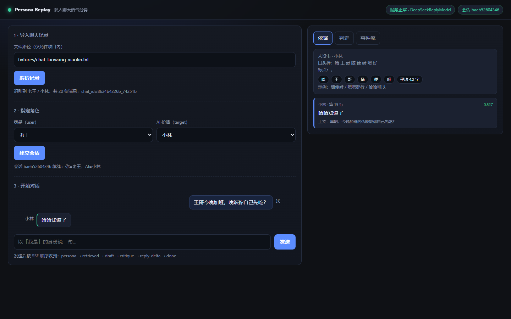

# Agent Studio Demo

双人聊天语气分身（Persona Replay）学习型 Demo。

项目目标：导入一份合成的双人聊天记录，指定用户角色和 AI 模仿角色，检索目标角色的历史回复，结合人设卡生成回复，并通过 Critic 检查语气、串台和事实幻觉。

> 本项目仅用于个人学习或已获得授权的数据实验。真实聊天记录不进入仓库、不写入完整日志，也不得用于冒充、诈骗或公开传播。

## 快速开始（一键构建 + 运行 + 打开前端）

```powershell
# Windows
.\run.ps1

# 跨平台（等价）
python manage.py run
python manage.py run --provider deepseek --port 8100 --stream
python manage.py build        # 只做构建检查：Python/前端/样例/compileall/导入冒烟
python manage.py test         # 只跑测试

# 方案文档的 7 条验收（可重复执行，失败退出码 1）
python -m tests.acceptance --provider deepseek

# 人工盲测：生成 10 轮题单 → 3 人各填一列 → 算准确率与 kappa
python -m evaluator.blind_test build --out runtime/blind
python -m evaluator.blind_test score runtime/blind/blind_sheet.csv
```

支持的导入格式：`.txt`（`姓名: 内容` / 时间戳头 / 续行）、`.csv`（微信式表头自动识别）、
`.html`（nickname + content 块）、`.jsonl`。人设卡可选 `PERSONA_LLM=1` 让模型补
"称呼 / 关系 / 口头禅 / 禁用词"四个语义字段。

`run` 会先做构建检查，再启动服务并自动打开 <http://127.0.0.1:8000/>。

## 可靠性（工程化补齐）

| 能力 | 行为 | 配置 |
|---|---|---|
| **模型重试** | 只重试临时故障：5xx / 超时 / 连接失败，指数退避 0.5s → 1s → 2s（上限 8s）；**4xx 一律不重试**（401/402/429/400 立即失败，避免重复计费） | `[model] max_retries = 2`、`retry_base_delay = 0.5` |
| **流式重试** | 只在**首 token 之前**重试；已经输出过内容就报错不重试（否则两段文本拼接 + 重复计费） | 同上 |
| **会话淘汰** | 按最后访问时间清理：默认 1 小时空闲、最多 64 个会话；淘汰时**同步删除 checkpoint** | `[server] session_ttl`、`session_max` |
| **导入缓存淘汰** | 人设卡/索引按 TTL + LRU 淘汰；被淘汰的会话**按原参数重建**，checkpoint 里的 `chat_id` 不会悬空 | `SESSION_TTL` / `SESSION_MAX`（同一组变量） |
| **CI** | GitHub Actions：Linux/Windows × Python 3.10/3.11 跑构建 + 全量测试；另一个 job 跑覆盖率（门槛 70%） | `.github/workflows/ci.yml` |
| **CI 可诊断** | 测试失败会转成 GitHub **annotation**（`file:line` + 断言消息）——日志下载接口要仓库权限，注解是公开可读的 | `tools/ci_report.py` |
| **工具链** | `ruff` 静态检查（未定义名/未用 import）+ `pytest` 跑全量（原生收集 unittest 用例，测试代码不用改） | `pyproject.toml`、`requirements-dev.txt` |
| **checkpoint 并发** | WAL + `busy_timeout`；启动时做一次写锁探测，被别的进程占着就**直接退出**并给出改法；运行期写锁冲突也翻译成可读错误 | `[server] checkpoint_path`、`memory/checkpoint.py` |
| **前端容错** | 请求超时 120s；断线显示横幅 + 「重试」；未输出内容时自动重试 2 次（0.5s/1.5s），已输出则只提示不自动重发 | `web/app.js` |
| **faithfulness** | 借 RAGAS 的定义自己实现（零依赖）：事实断言里能被证据支持的比例；全是语气句时记 n/a 而不是 0 | `evaluator/faithfulness.py` |
| **trace 标识** | 每轮一个 32-hex `trace_id`、每事件一个 16-hex `span_id`，另带 OTel 别名（`traceId`/`spanId`/`parentSpanId`） | `observability/trace.py` |

> 同一台机器起多个实例时，**必须给每个实例单独的 `CHECKPOINT_PATH`**，例如
> `$env:CHECKPOINT_PATH = 'runtime/api-8001.sqlite3'`。共用同一个文件会在启动时被拦下：
> ```text
> [xx] checkpoint 被另一个进程占用：runtime\api.sqlite3
> 给每个实例单独的数据库即可：$env:CHECKPOINT_PATH = 'runtime/api-<端口>.sqlite3'
> ```

### 可选集成（默认都不装）

`python -m integrations` 查看状态。装了就多一种实现，不装走内置：

| 库 | 用途 | 默认 | 说明 |
|---|---|---|---|
| mem0 | 事实抽取 + 去重（长期记忆） | 关闭 | 适配器已就绪，**未接主链路**；打开方式见 [docs/integrations.md](docs/integrations.md) |
| ragas | 指标对齐 | 关闭 | 适配器按 0.2+ 接口写；接口不符会明确报错并提示用内置实现 |
| langgraph | 官方编排引擎 | 自动 | 装了就走官方实现，否则退回自研同构引擎 |

> 为什么默认不接：mem0 每条消息多一次模型调用；ragas 要拉 datasets/langchain 一整套。
> 判断标准是"能不能只作为接口后面的一种实现"——能就接，不能就只借想法。

```powershell
# 本地跑覆盖率（CI 里同样的命令）
python -m pip install -r requirements-dev.txt
python -m ruff check .
python -m pytest -q
python -m coverage run --source=. --omit="tests/*,third_party/*,docs/*" -m pytest -q
python -m coverage report -m

# 看 CI 最近几次运行（含失败注解，不需要登录）
..\scripts\ci_status.ps1
```

> 编排引擎：装 `langgraph` 后默认走官方实现，否则退回零依赖的自研同构引擎
> （`GRAPH_ENGINE=auto|langgraph|builtin`）。两者行为有等价测试
> （`tests/test_langgraph_engine.py`）。
>
> 方案文档完成度审计（哪些做了、哪些没有）见
> [`docs/plan-status.md`](docs/plan-status.md)；7 条验收记录见
> [`docs/acceptance.md`](docs/acceptance.md)。



前端是**单个静态页**（原生 JS，无 Node、无构建），由同一个服务进程托管：
左边导入 → 选角色 → 对话（流式），右边三个页签分别是**依据 / 判定 / 事件流**。
设计说明与 SSE 契约见 [`docs/frontend.md`](docs/frontend.md)。

## 技术栈

### 核心技术选型

| 部分 | 技术 | 用途与原因 |
|---|---|---|
| 开发语言 | Python 3.10+ | Agent、RAG、LLM 和评估生态成熟，适合 15 天快速迭代（当前实测 3.10.4） |
| Agent 编排 | **官方 LangGraph**（可选依赖）+ 自研同构 `StateGraph`（零依赖兜底） | `GRAPH_ENGINE=auto` 时有 langgraph 就用官方实现（`add_conditional_edges` + `SqliteSaver` + `interrupt/Command`），没装自动退回；两个引擎跑同一批节点，行为有等价测试 |
| API 服务 | FastAPI + SSE | 导入、会话、流式回复、人工裁决（`api/main.py`） |
| 数据模型 | dataclass（API 入参用 Pydantic） | Agent State 保持零依赖可序列化；Pydantic 只出现在 HTTP 边界 |
| RAG 检索 | 词法索引（char-bigram + 上下文加权）；向量/扩写可插拔 | 基准 50 条语料 / 21 query（hard 9 条）；**LLM 扩写实测无净收益**，语义召回需 embedding，见 `docs/retrieval-l3-report.md` |
| 短期记忆 | 自研内存存储 | 当前 thread 的对话窗口（6 轮） |
| 长期记忆 | 自研人设卡 | 称呼、口头禅、句长、标点习惯 |
| 会话与断点 | SQLite | 每个 `thread_id` 一份 state，支持中断后恢复 |
| 评估测试 | unittest + 自研评估器 | 124 个单测；10 轮固定对白 + 规则指标 + 门禁 |
| 前端 | 原生 JS 单页（无构建） | 同一个服务进程托管，不需要 Node；右栏摊开"依据 / 判定 / 事件流" |
| 模型 | **DeepSeek 远程（OpenAI 兼容）已接入**；离线 `HeuristicReplyModel` 兜底 | 不下载本地模型；`python -m llm_client.check` 一键预检网络/鉴权/余额；换 `DEEPSEEK_BASE_URL` 即可接任何兼容端点 |
| 向量库 | **未接入**（Qdrant/Chroma 为规划项） | 20 条样例下词法已够，接库只会加复杂度 |
| 容器化 | `Dockerfile` 已写（**本机无 Docker，未验证**） | Day15 计划项；见 `docs/plan-status.md` |

> 说明：上表把"已实现"和"规划中"分开写，是因为"技术栈"里写一堆没接的东西，
> 等于给自己埋追问。

## 实际目录结构

```text
agent_studio_demo/
├── agent/              # 编排：graph（状态图/中断恢复）、nodes、state、react、control
├── transport/          # 传输层：handlers（纯业务）、events（UDP 观测）、bundle（TCP+UDP）
│   └── http/           # fastapi_adapter（可选依赖）/ stdlib_adapter（零依赖）/ static
├── api/                # 兼容入口（薄封装）+ 会话服务
├── web/                # 前端单页：index.html / app.js / style.css
├── llm_client/         # DeepSeek(OpenAI 兼容) / heuristic / scripted / factory / check
├── memory/             # 人设卡、短期窗口、SQLite checkpoint
├── rag/                # 词法索引、embedding、retriever、A/B、ab_test
├── tools/              # parse_chat、search_history、get_persona（只读白名单）
├── evaluator/          # 10 轮评估：rules、llm_judge、run
├── bench/              # loadtest（三后端压测）、model_probe（延迟/TTFT/token）
├── fixtures/           # 合成聊天 + 评估集 + 检索基准
├── docs/               # 设计文档与实测报告
├── tests/              # 单元测试 + ui_smoke（Playwright 验证脚本）
├── manage.py           # 一键构建/测试/运行（跨平台）
├── run.ps1 / run.sh    # 快捷入口
├── requirements.txt    # 核心零依赖
└── requirements-optional.txt  # 预留依赖（fastapi/uvicorn/httpx/granian）
```

## 运行时主链路

```text
导入双人聊天记录
        ↓
识别两个说话人，指定 user_speaker=A / target_speaker=B
        ↓
Planner 抽取 B 的人设卡
        ↓
索引 B 的发言，以及 A → B 的问答对
        ↓
用户以 A 的身份输入一句话
        ↓
Worker 检索 B 的相似历史回复并起草
        ↓
Critic 检查语气、串台和事实幻觉
        ↓
不通过：重新起草；涉及敏感内容：进入 HITL
        ↓
通过：以 B 的语气输出回复
        ↓
SSE 输出 persona、retrieved、draft、critique 和 reply
        ↓
通过 thread_id 保存会话，支持后续续聊
```

## 技术分层

```text
┌──────────────────────────────────────────────┐
│ 可选前端层                                    │
│ TypeScript + React                            │
└──────────────────────┬───────────────────────┘
                       ↓
┌──────────────────────────────────────────────┐
│ API 服务层                                    │
│ FastAPI + Pydantic + SSE                     │
└──────────────────────┬───────────────────────┘
                       ↓
┌──────────────────────────────────────────────┐
│ Agent 编排层                                  │
│ LangGraph：Planner → Worker → Critic → HITL  │
└──────────────┬───────────────┬───────────────┘
               ↓               ↓
┌────────────────────┐  ┌─────────────────────┐
│ 模型与工具层        │  │ 记忆与检索层         │
│ Ollama / LLM Client │  │ Memory + Chroma/Qdrant│
│ parse_chat          │  │ SQLite checkpoint    │
│ search_history      │  │ thread_id            │
│ get_persona         │  │                     │
└────────────────────┘  └─────────────────────┘
                       ↓
┌──────────────────────────────────────────────┐
│ 评估与交付层                                  │
│ pytest + 10 轮评估 + Docker                  │
└──────────────────────────────────────────────┘
```

## 为什么选择 Python

- LangGraph、FastAPI、Pydantic、向量数据库和 LLM SDK 可以直接组合。
- 适合快速实现 ReAct、RAG、记忆、Critic 和 HITL 等 Agent 能力。
- Ollama、本地 Embedding 和评估工具的 Python 示例更集中。
- 便于使用 pytest 对固定 10 轮对话做自动化回归测试。
- 当前 Demo 的重点是 Agent 工作流验证，不是极限服务吞吐量。

## 暂不引入的技术

- **Go**：服务性能优秀，但当前 Agent、RAG 和评估开发成本较高。
- **Java / Kotlin**：适合企业后端，但不适合本学习型 Demo 快速试验。
- **Rust**：性能和安全性优秀，但会增加 Agent 原型开发复杂度。
- **TypeScript 全栈**：可以实现，但暂不作为 Agent 主语言；只在需要完整 Web UI 时引入 React。
- **CrewAI / AG2**：用于源码和范式对比，不作为 Demo 运行时依赖。
- **完整 mem0 生产部署**：先使用自研记忆，后续再接入可插拔后端。
- **Redis、LangSmith 全量埋点、完整 IM 前端**：不属于当前 15 天主线。

## 开发顺序

1. 用合成数据完成聊天记录解析和说话人识别。
2. 实现 `parse_chat`、`search_history` 和 `get_persona` 工具。
3. 使用 LangGraph 打通 `retrieve → draft`。
4. 增加人设卡、Critic、重写条件边和历史证据输出。
5. 加入 checkpoint、thread_id、HITL 和 10 轮评估。
6. 最后封装 FastAPI、SSE 和 Docker。
7. 核心流程稳定后，再决定是否增加 TypeScript/React 前端。

## Day1 已完成

Day1 只实现合成数据和解析基础，不接入 LLM、向量库或外部消息发送：

- `fixtures/chat_laowang_xiaolin.txt`：20 条合成双人聊天，覆盖普通格式、带时间戳格式和多行消息。
- `tools/chat_parser.py`：解析 `姓名: 内容`、中英文冒号、时间戳行和续行；识别说话人并强制校验只能是两个人。
- `tests/test_chat_parser.py`：5 个解析器回归测试。
- `third_party/llm_agents/`：用户提供的 `llm_agents-main` 源码快照，保留 MIT License，作为 Day2 源码阅读参考；当前 Demo 不从项目外路径导入它。

运行解析器：

```powershell
python -m tools.chat_parser fixtures\\chat_laowang_xiaolin.txt
```

运行 Day1 测试（从项目根目录执行，当前环境无需安装 pytest）：

```powershell
cd D:\\code_2026\\AI_Agent\\agent_studio_demo
python -m unittest discover -s tests -t . -p "test_*.py" -v
```

如果当前不在项目根目录，也可以使用绝对路径：

```powershell
python -m unittest discover -s D:\\code_2026\\AI_Agent\\agent_studio_demo\\tests -t D:\\code_2026\\AI_Agent\\agent_studio_demo -p "test_*.py" -v
```

Day1 的解析数据结构暂时使用 Python 标准库 `dataclasses`，以保持基础链路零外部运行时依赖；后续 Agent State、人设卡和 Critic 结构化结果再统一接入 Pydantic。

## Day1 如何启动

当前 Day1 还没有 FastAPI 服务，也没有接入 LLM，因此不需要启动 Ollama、FastAPI 或 `uvicorn`。Day1 的“启动”就是运行聊天解析器命令行程序。

### 1. 进入项目根目录

```powershell
cd D:\\code_2026\\AI_Agent\\agent_studio_demo
```

### 2. 运行聊天解析器

```powershell
python -m tools.chat_parser fixtures\\chat_laowang_xiaolin.txt
```

预期输出：

```text
speakers: 老王, 小林
messages: 20
counts: {'老王': 10, '小林': 10}
老王: 小林，周五晚上要不要一起吃饭？
小林: 随便呀
...
```

这个命令的执行过程是：

```text
fixtures/chat_laowang_xiaolin.txt
        ↓
python -m tools.chat_parser
        ↓
parse_chat_file()
        ↓
读取 UTF-8 文本
        ↓
parse_chat_text()
        ↓
识别消息、时间戳、续行和说话人
        ↓
ParsedChat
        ↓
输出 speakers / messages / counts / 消息列表
```

### 3. 运行 Day1 测试

从项目根目录执行：

```powershell
python -m unittest discover -s tests -t . -p "test_*.py" -v
```

如果当前不在项目根目录，也可以执行：

```powershell
python -m unittest discover -s D:\\code_2026\\AI_Agent\\agent_studio_demo\\tests -p "test_*.py" -v
```

预期结果：

```text
Ran 5 tests
OK
```

## Day1 文件职责

```text
agent-studio-demo/
│
├── fixtures/
│   └── chat_laowang_xiaolin.txt
│       合成双人聊天输入文件
│
├── tools/
│   ├── __init__.py
│   │   声明 tools 为 Python 包
│   └── chat_parser.py
│       聊天记录解析器和命令行入口
│
├── tests/
│   ├── __init__.py
│   │   声明 tests 为测试包
│   └── test_chat_parser.py
│       Day1 解析器回归测试
│
└── third_party/
    ├── README.md
    │   第三方快照来源和使用约束
    └── llm_agents/
        用户提供的 llm_agents 源码快照
        Day2 ReAct 源码阅读参考
```

## Day1 代码阅读顺序

建议不要一开始就阅读整个项目，按下面顺序阅读：

### 第一步：阅读合成数据

文件：`fixtures/chat_laowang_xiaolin.txt`

重点观察：

1. 普通格式：`老王: 内容`
2. 中文冒号格式：`小林：内容`
3. 带方括号时间戳：`[2026-10-01 18:30] 老王: 内容`
4. 时间戳独占一行，下一行才是消息内容
5. 同一条消息跨多行的情况

先想清楚：解析器如何判断一行是新消息，如何判断一行是上一条消息的续行。

### 第二步：阅读数据结构

文件：`tools/chat_parser.py`

先看 `ChatMessage`：

- `speaker`：说话人
- `content`：消息内容
- `timestamp`：可选时间戳
- `line_number`：原始文件行号，便于错误定位

再看 `ParsedChat`：

- `messages`：解析后的消息列表
- `speakers`：按首次出现顺序返回说话人
- `speaker_counts`：统计每个人的消息数量
- `require_two_speakers()`：强制当前 Demo 只能处理双人聊天

### 第三步：阅读格式匹配规则

文件：`tools/chat_parser.py`

重点看两个正则：

- `_INLINE_MESSAGE`：匹配 `姓名: 内容`
- `_TIMESTAMP_HEADER`：匹配 `时间戳 + 姓名` 的消息头

解析时必须先判断 `_TIMESTAMP_HEADER`，再判断 `_INLINE_MESSAGE`，因为时间戳本身包含冒号，例如 `09:00:00`，如果顺序反了，时间可能被误认为普通消息分隔符。

### 第四步：阅读主解析流程

函数：`parse_chat_text()`

按以下逻辑阅读：

```text
逐行读取文本
    ↓
跳过空行
    ↓
先判断“时间戳 + 说话人”消息头
    ↓
再判断“说话人: 内容”单行消息
    ↓
如果是消息头，等待下一行作为消息内容
    ↓
如果不是新消息，追加到上一条消息作为续行
    ↓
文件结束时保存最后一条消息
    ↓
返回 ParsedChat
```

然后阅读：

- `parse_chat_file()`：负责从磁盘读取 UTF-8 文件
- `main()`：负责命令行参数、调用解析器和打印结果

### 第五步：阅读测试

文件：`tests/test_chat_parser.py`

测试和实现应该对照阅读：

| 测试 | 对应能力 |
|---|---|
| `test_parse_golden_fixture_identifies_two_speakers` | 黄金样例和双人识别 |
| `test_parse_timestamp_header_and_continuation_line` | 时间戳头和多行续写 |
| `test_parse_supports_colon_variants` | 中英文冒号 |
| `test_require_two_speakers_rejects_group_chat` | 拒绝三人群聊 |
| `test_unparseable_text_has_a_line_number` | 非法输入和错误行号 |

## Day1 运行流程图

```text
┌──────────────────────────────────────────┐
│ fixtures/chat_laowang_xiaolin.txt        │
│ 合成双人聊天记录                          │
└──────────────────┬───────────────────────┘
                   │ python -m tools.chat_parser
                   ↓
┌──────────────────────────────────────────┐
│ parse_chat_file(path)                    │
│ 读取 UTF-8 文件                           │
└──────────────────┬───────────────────────┘
                   ↓
┌──────────────────────────────────────────┐
│ parse_chat_text(text)                    │
│ 识别格式、说话人、时间戳和续行            │
└──────────────────┬───────────────────────┘
                   ↓
┌──────────────────────────────────────────┐
│ ParsedChat                               │
│ messages / speakers / speaker_counts     │
└──────────────────┬───────────────────────┘
                   ↓
┌──────────────────────────────────────────┐
│ require_two_speakers()                  │
│ 校验只能有老王和小林两个说话人            │
└──────────────────┬───────────────────────┘
                   ↓
┌──────────────────────────────────────────┐
│ CLI 输出                                 │
│ speakers / messages / counts / 消息内容  │
└──────────────────────────────────────────┘
```

## Day1 与第三方 llm_agents 的关系

文件：`third_party/llm_agents/llm_agents/agent.py`

Day1 暂时不运行第三方 Agent，只做源码快照和阅读准备。阅读时重点关注：

1. `Agent.run()`：ReAct 循环入口
2. `decide_next_action()`：调用 LLM 决定下一步动作
3. `_parse()`：解析 `Action` 和 `Action Input`
4. `ToolInterface`：工具接口抽象
5. `run_agent.py`：如何组装 Agent 和 Tools

Day1 自己实现的是“解析输入数据”；Day2 才会在此基础上实现 `parse_chat` 和 `search_history` 工具，并开始对照 ReAct 主循环。

## MVP 完成标准

- 能导入合成双人聊天记录并识别两个说话人。
- 能指定 `user_speaker` 和 `target_speaker`。
- 能建立目标角色发言和问答对索引。
- 回复前能召回历史原句作为依据。
- 能按人设卡生成目标角色口吻的短回复。
- Critic 能拦截明显助手腔、串台和记录中不存在的事实。
- `thread_id` 能保存当前对话并支持续聊。
- FastAPI 能演示导入、创建会话和 SSE 流式回复。


## Day2-Day6 已完成：Agent 基础闭环

Day2-Day6 在 Day1 解析器之上完成了一个**无外部依赖即可运行**的 Persona Replay 基础闭环：

```text
聊天文件
    ↓
Day2：手写 ReAct
    ├── parse_chat
    ├── search_history
    └── get_persona
    ↓
Day3：只读工具白名单
    ↓
Day4：PersonaCard + ShortTermMemory
    ↓
Day5：StateGraph
    ├── retrieve：解析、建索引、召回证据
    └── draft：根据证据和人设生成草稿
    ↓
Day6：SQLite checkpoint
    └── configurable.thread_id 支持续聊
```

### Day2：手写 ReAct 循环

文件：

- `agent/react.py`：实现 `Thought → Action → Observation` 循环、动作解析和最大循环次数。
- `tools/history_tools.py`：实现 `parse_chat`、`search_history`、`get_persona` 三个只读工具。
- `third_party/llm_agents/llm_agents/agent.py`：只作为源码对照，不作为运行时导入。

和第三方快照对照阅读时，重点看：

1. 第三方 `Agent.run()` 如何反复调用模型。
2. `Agent._parse()` 如何解析 `Action` 和 `Action Input`。
3. 本项目如何把相同思想改成可测试的 `ReActAgent.parse_action()`。
4. 本项目没有外部 LLM 时，使用确定性的默认策略，保证可以先观察完整循环。

默认策略依次执行：

```text
parse_chat
    ↓
search_history
    ↓
get_persona
    ↓
Final Answer：返回历史证据
```

### Day3：工具权限和安全边界

`ToolRegistry` 是显式白名单。当前允许的工具只有：

| 工具 | 作用 | 是否允许写外部系统 |
|---|---|---|
| `parse_chat` | 解析本地 UTF-8 聊天文件 | 否 |
| `search_history` | 检索目标角色历史回复 | 否 |
| `get_persona` | 提取本地人设卡 | 否 |

没有注册的工具会直接抛出 `ValueError`。例如 `send_message` 不在白名单中，因此 Day2-Day6 不具备向外发送消息的能力。

### Day4：记忆和人设卡

文件：

- `memory/persona.py`：`PersonaCard`、`build_persona_card()`、`PersonaStore`。
- `memory/persona.py`：`ShortTermMemory`，按最大轮数保存当前线程的对话窗口。

`PersonaCard` 当前是可解释的启发式结果，包括：

- 目标说话人和消息数量
- 平均消息长度
- 常见词
- 常见标点
- 是否使用表情
- 前几条历史回复示例

当前没有调用 LLM 抽取人设，也没有接入 mem0；这样可以先读懂数据如何进入状态。后续只需替换 `build_persona_card()`，不需要改主图接口。

### Day5：`retrieve → draft` 主图

文件：

- `rag/history_index.py`：本地词法历史索引，返回带 `score`、原始行号和上下文的 `HistoryHit`。
- `llm_client/heuristic.py`：无外部服务的确定性回复模型，后续可替换为 Ollama。
- `agent/state.py`：可序列化的 `AgentState`。
- `agent/graph.py`：`StateGraph`、节点、边和 `PersonaReplayRuntime`。

主图只有两个节点，便于第一次读 Agent 编排：

```text
retrieve
  ├── parse_chat_file()
  ├── require_two_speakers()
  ├── build_persona_card()
  ├── HistoryIndex.from_chat()
  └── index.search(user_input)
        ↓
draft
  ├── PersonaCard.from_dict()
  ├── HistoryHit.from_dict()
  ├── ReplyModel.generate()
  └── ShortTermMemory.add_turn()
```

当前环境没有安装 `langgraph`，因此 `agent/graph.py` 提供了一个小型、可读的兼容实现，保留 LangGraph 要学习的核心概念：`StateGraph`、State、Node、Edge、`invoke()` 和 `configurable.thread_id`。它不是把 LangGraph 冒充成已安装依赖；后续安装真实 LangGraph 后，可以把节点函数原样迁移到官方 `StateGraph` API。

### Day6：checkpoint 和续聊

文件：`memory/checkpoint.py`

`SQLiteCheckpointer` 使用 Python 标准库 `sqlite3`，每个 `thread_id` 保存一份 JSON State：

```text
第一次 invoke(thread_id="demo-thread")
    ↓
retrieve → draft
    ↓
保存 persona / retrieved / reply / short_memory / turn_count
    ↓
第二次 invoke(thread_id="demo-thread")
    ↓
加载上一份 State，只传新的 user_input
    ↓
继续 retrieve → draft，并追加一轮短期记忆
```

注意：`thread_id` 是会话身份，不是说话人身份。不同 `thread_id` 的对话互相隔离。

## 用 DeepSeek API（不升级 Cursor）

Cursor 免费版不能在聊天框里选 `deepseek-flash`，但本 Demo **可直接调 DeepSeek 云 API**。费用只扣你在 [platform.deepseek.com](https://platform.deepseek.com) 的余额。

1. 复制**配置文件模板**并填入 Key（推荐；`settings.ini` 已在 `.gitignore`，不会被提交）：

```powershell
cd D:\code_2026\AI_Agent\agent_studio_demo
Copy-Item config\settings.ini.example config\settings.ini
# 用编辑器打开 config\settings.ini，填 [model] 下的 api_key
```

`config/settings.ini` 用 INI 格式，一个文件管模型 / 服务 / 功能开关 / 检索阈值，每项都有注释。
仓库里只提交 `settings.ini.example`（值全空），所以**别人的 key 不会被你看到，你的 key 也不会进仓库**。

2. 或临时用环境变量覆盖（优先级最高，适合一次性试验）：

```powershell
$env:DEEPSEEK_API_KEY = "sk-你的密钥"
$env:DEEPSEEK_MODEL = "deepseek-flash"
```

3. 检查配置（不打印密钥，只报来源）：

```powershell
python -m llm_client.check
```

3. 运行（`--provider deepseek` 强制走 DeepSeek；`auto` 则有 Key 就用 DeepSeek，否则用本地 heuristic）：

```powershell
python -m agent.demo --provider deepseek --message "周五晚上吃饭吗？" --thread-id demo-thread
```

成功时开头会打印：`provider: deepseek -> DeepSeekReplyModel`，并看到基于检索历史的 `reply`。

说明：

- 无需安装额外 SDK，使用标准库请求 `https://api.deepseek.com`
- 默认模型 `deepseek-flash`，可用环境变量 `DEEPSEEK_MODEL` 改成 `deepseek-v4-pro`
- 单元测试仍默认用本地 `HeuristicReplyModel`，不消耗 API 额度
- 真实私聊记录仍建议优先本地模型；当前样例是合成数据 `fixtures/chat_laowang_xiaolin.txt`

## Day2-Day6 如何启动

从项目根目录执行：

```powershell
cd D:\\code_2026\\AI_Agent\\agent_studio_demo
python -m agent.demo --message "周五晚上吃饭吗？" --thread-id demo-thread --show-react
```

也可以指定说话人和输入文件：

```powershell
python -m agent.demo `
  --chat-path fixtures\\chat_laowang_xiaolin.txt `
  --user-speaker 老王 `
  --target-speaker 小林 `
  --message "那周六呢？" `
  --thread-id demo-thread
```

如果想让 checkpoint 跨进程保存，指定 SQLite 文件：

```powershell
python -m agent.demo `
  --message "周五晚上吃饭吗？" `
  --thread-id demo-thread `
  --checkpoint runtime\\checkpoints.sqlite3
```

命令输出中重点观察：

- `persona`：Day4 生成的人设卡
- `retrieved`：Day5 召回的历史原句和分数
- `draft` / `reply`：Day5 的回复结果
- `saved_turns`：Day6 当前 thread 已保存的对话轮数
- `react_trace`：Day2 每次工具调用及 Observation

## Day2-Day6 代码阅读顺序

建议按下面顺序阅读，不要从 `agent/graph.py` 第一行直接跳进去：

1. `tools/history_tools.py`：先理解工具输入输出为何使用 JSON。
2. `rag/history_index.py`：看历史记录如何变成可检索的 `HistoryHit`。
3. `agent/react.py`：对照第三方源码理解 ReAct 循环。
4. `memory/persona.py`：看长期人设卡和短期窗口的区别。
5. `llm_client/heuristic.py`：看模型接口为何可以被替换。
6. `agent/state.py`：看主图中哪些字段必须可序列化。
7. `agent/graph.py`：最后看 Node、Edge、State 和 checkpoint 如何串起来。
8. `agent/demo.py`：从命令行入口回看一次完整调用链。
9. `tests/test_day2_tools.py`、`tests/test_day4_memory.py`、`tests/test_day5_day6_graph.py`：用测试确认每个阶段的边界。

## Day2-Day6 测试

项目当前仍然不依赖 pytest，直接运行：

```powershell
python -m unittest discover -s tests -t . -p "test_*.py" -v
```

Day2-Day6 新增 7 个测试，加上 Day1 的 5 个测试，共 12 个测试。覆盖：

- 工具解析和历史检索
- 禁止未注册的外部发送工具
- ReAct 三次只读工具调用
- 人设卡提取和短期记忆窗口
- `retrieve → draft` 主图
- 同一 `thread_id` 的续聊
- 缺少 `thread_id` 时拒绝执行

## Day7-Day9 已完成：单轮跑稳 + 三节点 + Critic 条件边

主图从 `retrieve → draft` 扩成：

```text
planner ──> retrieve ──> draft ──> critic
               ↑                    │
               │   rewrite          │
               └────── draft ←──────┤
                                    ├── pass ──> END
                                    └── escalate ──> escalate ──> END
```

### Day7：先让单轮真的跑稳（4 个实测问题）

| 问题（Day6 之前） | 修正 | 现在的事实 |
|---|---|---|
| 检索靠**单字**重叠，虚词（了/知/道）能把无关历史顶上来 | 中文改为 **char-bigram**（`rag/history_index.py`），token 向量在构造时预计算 | 黄金样例 top1 = line 15 `哈哈知道了` |
| 分数里 `exact_bonus=2.0`，量纲混乱、**无法设阈值** | 归一化到 [0, 1]，并把上下文与回复分列计分 | `score=0.5274 (ctx=0.7526, content=0.0)` |
| 检索对了但**生成没用上**：`HeuristicReplyModel` 要求 `score >= 1.0`，永远达不到 | 阈值改为 `EVIDENCE_THRESHOLD = 0.4` | 黄金样例回复从模板 `随便呀` 变成证据原句 `哈哈知道了` |
| 每轮重新解析文件、重建索引 | 新增 `ingest/session_store.py`；缓存键 = 路径 + mtime + size + 说话人 | 第二轮**不需要** `chat_path` |
| 0.0009 分的噪声也被当成"依据" | `MIN_EVIDENCE_SCORE = 0.05` 过滤 | `那周六呢？` → `(no evidence above threshold)` |

为什么**上下文权重 0.7、回复本身只有 0.3**：用户这句话对应的是历史里 A 的那句话，
B 的回复是随证据一起返回的"答案"。拿用户的句子去跟 B 的回复比相似度，方向是反的。

### Day8：拆成 Planner / Worker / Critic

新增 `agent/nodes.py`，节点契约是 `(state) -> dict` 的**增量**返回，分叉交给 router：

| 节点 | 职责 | 关键约束 |
|---|---|---|
| `planner` | 导入时解析、建索引、抽人设卡 | 只跑一次：`persona_ready` 为真后直接返回 `{}` |
| `retrieve` | 召回证据，低于阈值不返回 | 没有会话时可用 `chat_path` 自举，便于单测 |
| `draft` | 按人设与证据起草；重写时带上 critique | 重写是**替换**本轮记忆，不是追加（`ShortTermMemory.replace_last_reply`） |
| `critic` | 规则判定语气/串台/事实 | 见下表；`verdict ∈ {pass, rewrite, escalate}` |
| `escalate` | 降级出口 | 输出最保守的短句并把 `status` 置为 `escalated` |

`AgentState` 新增 `chat_id` / `persona_ready` / `critique` / `rewrite_count` / `status`。
`chat_id` 只是引用：人设卡和索引属于派生数据，放在 `session_store`，**不进 state**，
否则 checkpoint 会被撑成 MB 级。

### Day9：Critic 条件边与重写循环

**调度器改造是前置条件**：旧实现用 `visited` 集合禁止重复访问节点，而 Critic 重写
天然是一条回边，所以"防死循环"把功能一起禁掉了。改成 **步数预算**（`max_steps`，
默认 12）后：

- 正常一轮 4 步；两次重写 9 步；超出预算 → `status="budget_exhausted"` 降级返回，
  **不抛异常**（模型绕圈是预期内的失败，不应该变成 500）。
- 每步都落 checkpoint，`steps` 记录真实执行路径，排查时能直接看出卡在哪一层。

Critic 的判据（**能代码判的绝不用 LLM**，成本为 0）：

| 判据 | 实现 | 触发示例 |
|---|---|---|
| `assistant_tone` | 黑名单短语（`作为AI` / `以下是` / `建议你` …） | `作为AI，我建议你早点休息` |
| `too_long` | 长度 > `max(16, 平均句长 × 3)` | — |
| `crosstalk` | 回复中出现**另一人原话的连续 6 字** | 抄了老王的"周末的电影票我已经买好" |
| `unsupported_fact` | 回复里的数字必须出现在召回证据里 | `密码是123456` |
| `repeated` | 与上一轮回复完全相同 | — |

重写两次仍不过 → `escalate`，输出 `嗯，知道了` 并把最终 `critique` 留在状态里供审计。
`rewrite_count` 与 `critique` **每轮重置**，否则上一次降级的会话下一轮会立刻再降级。

> 已知边界：中文数字（六点半）不会被 `unsupported_fact` 识别；串台检测只看
> 连续 6 字抄写，换词改写抓不到。这两处留给 LLM 判定做补充。

### Day7-Day9 如何验证

```powershell
cd D:\code_2026\AI_Agent\agent_studio_demo

# 全量测试（Day1-Day9 共 39 个）
python -m unittest discover -s tests -t . -p "test_*.py" -v

# 黄金样例一轮
python -m agent.demo --provider heuristic `
  --message "王哥今晚加班，晚饭你自己先吃？" `
  --thread-id demo-thread --checkpoint runtime\day9.sqlite3

# 同一 thread 第二轮（不必再传 --chat-path）
python -m agent.demo --provider heuristic --message "那周六呢？" `
  --thread-id demo-thread --checkpoint runtime\day9.sqlite3
```

第一轮重点看：

```text
retrieved:
  - score=0.5274 (ctx=0.7526, content=0.0): 哈哈知道了 (line 15)
critique: {"verdict": "pass", "problems": [], "rewrites": 0}
status: ok
steps: planner -> retrieve -> draft -> critic
```

第二轮重点看 `(no evidence above threshold)` 与 `saved_turns: 2`：**没有依据时就说没有**，
不拿噪声冒充证据。

### 新增测试（12 → 39）

| 文件 | 钉住的行为 |
|---|---|
| `tests/test_day7_golden.py` | bigram 分词、黄金样例命中 line 15、阈值过滤、会话只解析一次、第二轮免 `chat_path` |
| `tests/test_day8_nodes.py` | Planner 只跑一次 / 缺 `chat_path` 报错 / 同角色报错；Worker 自举检索、重写替换而非追加 |
| `tests/test_day9_critic.py` | 5 条规则判据、router 映射、两次重写后降级、改好即通过、降级不串轮、预算耗尽不抛异常 |
| `tests/fakes.py` | `ScriptedModel`：让"模型不听话"的路径可被稳定复现 |

## Day10 已完成：检索策略 A/B

同一份索引、15 条标注 query、四种策略：

```powershell
python -m rag.ab_test
```

实测结果（`fixtures/retrieval_eval.json`）：

```text
retriever                            n  hit@1  hit@3    mrr    fp
-----------------------------------------------------------------
lexical                             13  0.846  0.846  0.862 0.000
lexical+expand                      13  0.923  1.000  0.962 0.000
vector:hashing-256                  13  0.846  0.846  0.862 0.000
hybrid(lexical+expand+vector:…)     13  0.846  1.000  0.910 0.000

hit@1 by group:
retriever                             same_situation    paraphrase      hard
lexical                                  1.000 (n=9)   1.000 (n=2)  0.000 (n=2)
lexical+expand                           1.000 (n=9)   1.000 (n=2)  0.500 (n=2)
vector:hashing-256                       1.000 (n=9)   1.000 (n=2)  0.000 (n=2)
hybrid(lexical+expand+vector:…)          1.000 (n=9)   1.000 (n=2)  0.000 (n=2)
```

四个结论（这些比数字本身有用）：

1. **同情境/近改写已经满分，没有优化空间**。在 20 条合成数据上换检索策略不会有收益，
   所以"上向量库"在这个规模是纯负担。
2. **哈希向量和词法打平（0.846 vs 0.846）**，因为特征哈希的信息量和 bag-of-bigram
   等价。想靠"换向量库"提升召回是错的，要换的是**语义**。
3. **查询扩写把 hard 组从 0 提到 0.5，但那是人工同义词表的功劳**，不是模型的功劳；
   而且被救回的那条分数只有 0.10，低于 `MIN_EVIDENCE_SCORE=0.12`，实际链路仍会丢弃。
   **排名提升 ≠ 可用证据。**
4. **融合不是免费的**：RRF 把一个没有信息量的检索器混进来，会把本来排第一的正确答案
   压到第二（MRR 0.962 → 0.910，hit@1 0.923 → 0.846）。

> 想真正支持改写召回，只有两条路：接语义 embedding（`HttpEmbedder` 已备好，需要
> `EMBEDDING_BASE_URL` / `EMBEDDING_API_KEY`），或者给同义词表补领域词。
> 而且**阈值必须按后端重新标定**——0.12 是给词法量身定的，换后端不能复用。

## Day11 已完成：HITL（中断 / 落盘 / 恢复）

`escalate` 节点换成了 `human_review`：不再静默降级，而是抛 `GraphInterrupt`。

```text
critic ──pass──────> END
   │
   ├──rewrite────> draft（最多 2 次）
   │
   └──review─────> human_review ──┬── approve → END（保留原文）
                                  ├── edit    → END（替换正文，并同步短期记忆）
                                  └── reject  → END（兜底短句，status=rejected）
```

**中断时落盘什么**：`status="interrupted"` + `pending{reason, problems, categories,
reply, allowed_actions, resume_at}`。`resume_at` 由调度器补上（当前节点的后继），
所以 `resume()` 是**从恢复点继续**，不是把整轮重放——两者的副作用完全不同。

敏感类目（命中即交人，不自动重写）：

| 类目 | 触发词示例 |
|---|---|
| `credential` | 密码 / 验证码 / 身份证 / 银行卡 / 账号 |
| `money` | 转账 / 打钱 / 借钱 / 借你 / 红包 / 工资 |
| `address` | 家庭住址 / 住哪 / 门牌 / 具体地址 |
| `commitment` | 保证 / 答应你 / 发誓 / 一定会 / 结婚 |
| `health` | 吃药 / 病历 / 确诊 / 医院 |

为什么敏感内容不重写：语气问题重写能修，"要不要答应借钱"重写修不了，**那是人的决定**。

```powershell
# 触发中断
python -m agent.demo --message "王哥今晚加班" --provider heuristic
# 中断后带裁决再跑一次（同一 thread）
python -m agent.demo --message "王哥今晚加班" --decision edit --reply "哈哈这个不说"
```

## Day12 已完成：10 轮评估 + 回归门禁

```powershell
python -m evaluator.run            # 规则评估（零成本）
python -m evaluator.run --gate     # CI：不达标退出码 1
python -m evaluator.run --judge llm --json   # 需要 DEEPSEEK_API_KEY
```

实测（`fixtures/eval_rounds.json`，6 条干净轮次 + 4 条对抗轮次）：

```text
expectation_pass_rate  1.0
style_similarity       0.4962   （只算干净轮次）
crosstalk_rate         0.0
hallucination_rate     0.0
assistant_tone_rate    0.0
catch_rate             1.0      （对抗轮次全部被正确拦下）
human_review_rate      0.4
evidence_coverage      0.3333
gate: PASS
```

关键设计：**指标按轮次分组**。第一版把"对抗轮次被拦截"也算进失败率，结果
"系统正确拦住一次编造"被统计成"系统失败"——分组后才是有意义的指标。

指标定义（`evaluator/rules.py`，独立计算，不读 Critic 结论）：

| 指标 | 算法 |
|---|---|
| `style_similarity` | 句长接近度 0.5 + 标志性用词命中 0.3 + 标点习惯 0.2 |
| `crosstalk` | 回复里出现另一人原话的连续 6 字 |
| `hallucination` | 回复中的阿拉伯数字不在召回证据里 |
| `assistant_tone` | 黑名单短语命中 |

**诚实边界**：10 个样本的二项比例，95% 置信区间宽度约 ±30 个百分点。所以这个
门禁只用来**防回归**（改 prompt 前后跑同一套），不用来宣称"效果提升 X%"。

## Day14 已完成：传输层（TCP + UDP）+ FastAPI/标准库双适配器

HTTP 框架是可替换的**适配器**，业务在 `transport/handlers.py` 里，不依赖任何框架：

```text
transport.handlers     纯业务：(payload) -> (status, payload)，SSE 用事件迭代器
transport.http.*       协议适配：fastapi_adapter（可选依赖）/ stdlib_adapter（零依赖）
transport.events       观测通道：EventBus → UdpSink / JsonlSink / NullSink
transport.bundle       生命周期：一个进程同时起 TCP 服务与 UDP 上报
```

```powershell
# 一个进程：TCP 8000 + UDP 观测上报到 8126（终端 A 先跑 udp_listen）
python -m transport --port 8000 --udp-port 8126
python -m transport --adapter stdlib --port 0      # 强制零依赖适配器
python -m transport --server granian --port 8000   # 指定 Rust 服务器
python -m transport.udp_listen --port 8126         # 接收端（另一个终端）
python -m api.main                                 # 兼容老入口
```

### 适配器 × 服务器（两个正交维度）

| | uvicorn | granian | stdlib |
|---|---|---|---|
| **fastapi** | 生态默认 | ✅ 传输层快 ~22% | ✗ |
| **stdlib** | ✗ | ✗ | 零依赖，最快 |

`--server auto` 的顺序是 **granian > uvicorn > stdlib**（按实测吞吐，选已安装的）。

实测数据（`python -m bench.loadtest`，服务器独立进程，2s × 8/4 并发）：

```text
server     adapter    health rps     p50     p95   turns/s     p50     p95
stdlib     stdlib         7327.3    1.01    1.92    918.60     4.2     5.7
uvicorn    fastapi        2467.3    3.12    4.29    563.60     7.0     9.2
granian    fastapi        3020.3    2.53    3.72    555.40     7.1     9.0
```

**结论反直觉但可复现**：granian 的传输层比 uvicorn 快 ~22%（3020 vs 2467），
但端到端一轮扮演吞吐持平（555 vs 564）——瓶颈在框架层（pydantic + ASGI 调度），
不在服务器层。标准库适配器因为跳过 pydantic，反而快 1.6–2.9 倍。
方法与取舍见 [`docs/performance.md`](docs/performance.md)。

实测输出（TCP 走业务、UDP 走 trace，互不影响）：

```text
HTTP reply: 哈哈知道了 | status: ok | verdict: pass          ← TCP

11:32:54.649 planner   status=ok hits=0                      ← UDP
11:32:54.659 retrieve  status=ok hits=1  ms_prev=9.657
11:32:54.669 draft     status=ok hits=1  ms_prev=8.088
11:32:54.679 critic    status=ok verdict=pass ms_prev=9.849
11:32:54.689 done      status=ok turn=1
```

两条通道的分工是硬约束，不是偏好：**HTTP 跑不了 UDP**（HTTP/3 是 QUIC，需要专门库），
SSE 也只能走 TCP。所以 TCP 承载"不能丢"的东西，UDP 只承载"丢了不影响正确性"的观测事件，
且事件里**没有对话内容**（只有长度、命中数、判定结果）。

两个适配器用**同一套契约测试**跑（`tests/test_transport.py::ContractTests`），
状态码与 SSE 帧格式完全一致。设计取舍与限制见 [`docs/tcp-udp.md`](docs/tcp-udp.md)。

> `fastapi` / `uvicorn` / `httpx` 仍是预留依赖：`pip install -r requirements-optional.txt`。
> 没装时自动退回标准库适配器，接口测试自动 skip，核心链路不受影响。

| 方法 | 路径 | 作用 |
|---|---|---|
| GET | `/health` | 存活检查 |
| POST | `/chats/import` | 解析记录、返回说话人与人设卡（不建会话） |
| POST | `/sessions` | 建会话 = 跑一次 Planner，返回 `session_id`（= thread_id） |
| GET | `/sessions/{id}` | 查看当前 state |
| POST | `/sessions/{id}/messages` | 一轮完整扮演（非流式） |
| GET | `/sessions/{id}/stream?message=` | 一轮完整扮演（SSE） |
| POST | `/sessions/{id}/resume` | 人工裁决后续跑（approve / edit / reject） |
| DELETE | `/sessions/{id}` | 删除会话（数据最小化落地） |

SSE 事件顺序（实测输出）：

```text
event: persona      { persona, speakers, user_speaker, target_speaker }
event: retrieved    { hits: [...] }            ← 依据先于正文
event: draft        { draft }
event: critique     { critique }
event: reply_delta  { delta }   × N
event: done         { status, reply, turn_count, rewrite_count, steps }
```

需要人工时：`… → critique → interrupt → done(status=interrupted)`，且**不发
`reply_delta`**（未经批准的正文不该流出去）。

状态码约定：未知会话 `404`、非法动作 `422`、对未中断会话调 resume `409`、
参数错误 `400`。

启动示例：

```powershell
$env:PROVIDER="heuristic"
$env:CHECKPOINT_PATH="runtime\api.sqlite3"
python -m api.main
```

```powershell
curl.exe -X POST http://127.0.0.1:8000/sessions `
  -H "Content-Type: application/json" `
  --data-binary "@session.json"     # {"path":"fixtures/chat_laowang_xiaolin.txt","user_speaker":"老王","target_speaker":"小林"}

curl.exe -N --get "http://127.0.0.1:8000/sessions/<sid>/stream" --data-urlencode "message=那周六呢？"
```

> 注意：`reply_delta` 目前是**回合结束后按块回放**，不是模型 token 级流式——图是同步
> 执行的。`retrieved` / `critique` / `interrupt` 是节点跑完立刻推的真事件。

## 依赖与环境

核心链路（解析 / 检索 / 状态图 / checkpoint / 评估 / A-B / CLI）**零第三方依赖**；
`requirements.txt` 故意不装任何东西。可选能力（HTTP 层、向量库、本地模型…）统一
登记在 `requirements-optional.txt`，需要时一次装完：

```powershell
python -m pip install -r requirements-optional.txt   # fastapi / uvicorn / httpx
```

缺可选依赖时**不会崩**：`create_app()` 抛带安装指令的 `DependencyMissing`，
HTTP 接口测试自动 `skip`（15 个），其余 77 个用例照常绿。策略与预留清单见
[`docs/dependencies.md`](docs/dependencies.md)。

环境变量：

| 变量 | 作用 |
|---|---|
| `DEEPSEEK_API_KEY` / `DEEPSEEK_MODEL` / `DEEPSEEK_BASE_URL` | 启用远程模型（`--provider deepseek`）；任何 OpenAI 兼容端点都行 |
| `STREAM` | `1` 开启 token 级流式（事件顺序会变成正文先于判定） |
| `EMBEDDING_BASE_URL` / `EMBEDDING_API_KEY` / `EMBEDDING_MODEL` | 语义 embedding 后端（DeepSeek 没有公开 embeddings 接口） |
| `PROVIDER` | API 服务的回复模型：`auto` / `heuristic` / `deepseek` |
| `ADAPTER` / `SERVER` | 传输后端：`auto` / `fastapi` / `stdlib`；`auto` / `granian` / `uvicorn` / `stdlib` |
| `CHECKPOINT_PATH` | API 的 SQLite 路径，默认 `runtime/api.sqlite3` |
| `HOST` / `PORT` / `UDP_PORT` / `TRACE_JSONL` | 监听地址、UDP 观测、本地 trace 落盘 |

远程模型的三步接通、流式事件顺序、以及"为什么不下载 Ollama"，
见 [`docs/remote-model.md`](docs/remote-model.md)。一句话：

```powershell
python -m llm_client.check      # 0=通 / 1=失败 / 2=没配 key
python -m agent.demo --provider deepseek --message "王哥今晚加班，晚饭你自己先吃？"
python -m bench.model_probe --provider deepseek -n 3    # 延迟/TTFT/token
```

### 真模型实测（DeepSeek，2026-10-23）

| 指标 | 值 |
|---|---|
| 连通性 | `check` 通过，793 ms |
| 整轮 p50 / p95 | 863 ms / 956 ms（其中模型占 721 ms） |
| 首 token（TTFT） | 728 ms ≈ 非流式 → **短回复下流式只省 13%** |
| tokens/轮 | 282 in + 2.3 out ≈ **¥0.0003/轮**（1000 轮 ≈ ¥0.3） |
| 规则分（6 条干净轮次） | 真模型 **0.4717** vs 模板 **0.4962** → **指标偏置** |
| 语义判定（L2） | 真模型幻觉 0%，模板模型 **16.7%**（"在吗"→"可以呀，你定时间～"） |

两个结论值得记住：

1. **L1 规则分不能用来比较"模板 vs 真模型"**——模板就是按这些统计量生成的，
   指标天然偏袒它。要比就看 L2/人工。
2. **反幻觉 prompt 泄漏元话语**（"记录里没提过"）是"一眼看出是 AI"的最短路径；
   已修，修后是"啥呀，没说过啊"。

完整数据与复现命令见 [`docs/real-model-report.md`](docs/real-model-report.md)。

> **隐私边界**：远程模型意味着对话内容离开本机。仓库只用合成样例所以没问题；
> **真实私聊记录不要配远程模型**。

## 已知限制（汇总）

| # | 限制 | 影响 | 下一步 |
|---|---|---|---|
| 1 | 检索是词法，语义改写（"片子"↔"电影"）靠人工同义词表；**LLM 扩写实测无净收益** | hard 组 hit@1 0.333，上界约 0.44 | 接语义 embedding（需另一家 key），基准已就绪 |
| 2 | `unsupported_fact` 只认阿拉伯数字 | 中文数字（六点半）漏判 | 归一化中文数字 |
| 3 | 串台只抓"连续 6 字抄写" | 换词模仿抓不到 | 用 LLM judge 补 |
| 4 | `reply_delta` 默认是回合结束后的回放 | 默认模式首字延迟无改善 | `STREAM=1` 已支持 token 级（顺序变为正文先于判定） |
| 5 | 图是同步执行，靠线程池 + 队列包成流 | 高并发下线程数会涨 | 全链路 async |
| 6 | 无鉴权、无限流、无多租户 | 只能本机/内网 | 加 API Key + 限流 |
| 7 | checkpoint 存 `user_input` 原文 | 接真实私聊前必须脱敏 | 落盘前脱敏 + 加密列 |
| 8 | 未做 Docker / 前端 | 交付形态只有 API | Day15 |

## TODO（按优先级）

1. 迁移到官方 LangGraph（节点函数已按它的 API 形状写，换壳即可）。
2. 接语义 embedding，并用同一套 `rag/ab_test.py` 重跑对比。
3. checkpoint 落盘脱敏 + TTL。
4. Dockerfile + 前端最小页面。


