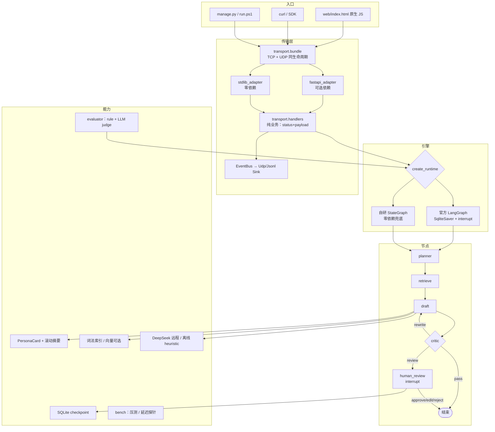

# 方案文档完成度审计（逐条对照）

> 对照对象：`AI Agent 开源项目源码阅读指南 + Demo 整合方案 + Mermaid 架构图.md`
> 审计时间：2026-10-23 ｜ 代码状态：142 个单测通过、7/7 验收通过
> 图例：✅ 已实现并验证 ｜ ⚠️ 部分实现 ｜ ⬜ 未做 ｜ 📖 代码无法代做（需要你本人）

---

## 一、场景与产品约定（文档「零」节）

| 条目 | 状态 | 证据 / 说明 |
|---|---|---|
| 五步主链路（解析 → 选角 → 检索 → 人设起草 → Critic） | ✅ | `agent/graph.py` 的 planner→retrieve→draft→critic |
| 只支持双人、强制选 A/B | ✅ | `require_two_speakers()`、`planner_node` 校验 |
| AI 只扮演 target，不替双方各说各话 | ✅ | prompt + `critic` 的串台检测 |
| 回复优先级：历史原句 > 人设卡 > 自由发挥 | ⚠️ | prompt 里写了；真模型实测优先复用了证据（`哈哈知道了`），但没有强制排序机制 |
| 记录里没有的事禁止编造 | ⚠️ | prompt 有效（实测 3/3 答"啥呀…"），规则层只能拦数字/敏感词；见「缺失」第 4 条 |
| 仓库只放合成样例、真实记录 gitignore、默认本地模型 | ⚠️ | 合成样例 ✅；`.env` 已 gitignore ✅；**默认模型改成了远程 DeepSeek**（你确认过的选择），真实记录不要配远程 |
| 10 行模块职责表（ReAct/短记忆/长记忆/RAG/Planner/Worker/Critic/HITL/评估/FastAPI） | ✅ | 全部落地，见各目录 |

## 二、7 条验收标准

| # | 验收项 | 状态 | 实测证据（`python -m tests.acceptance --provider deepseek`） |
|---|---|---|---|
| 1 | 导入：解析、列说话人、建索引与人设卡 | ✅ | `speakers=['老王','小林'] messages=20 persona=小林 avg_len=4.2` |
| 2 | 主路径：检索后用对方语气回复 | ✅ | `reply='哈哈知道了' verdict=pass model=DeepSeekReplyModel` |
| 3 | 依据可见：SSE 打出召回原句 | ✅ | `retrieved` 事件 top1=`哈哈知道了` line=15 score=0.5274 |
| 4 | 语气约束：拦助手腔 / 串台 | ✅ | 两条对抗用例都 `interrupted` |
| 5 | 反幻觉：不编造记录里没有的事 | ✅ | 三条诱导都答「啥呀，没说过啊 / 问这个 / 谁说的」，无日期、无"记录"字眼 |
| 6 | 记忆：不丢主题 + 同 thread 续跑 | ✅ | `turn_count=8 window=6 summary_len=46`，重新加载仍为 8 |
| 7 | 服务：import / sessions / stream | ✅ | SSE `persona → retrieved → draft → critique → reply_delta… → done` |

**7/7 通过**。完整输出见 [`acceptance.md`](acceptance.md)。

## 三、15 天时间线（文档「二」节）

| 天 | 计划 | 状态 | 落地位置 |
|---|---|---|---|
| Day1 | 合成样例 + 解析器 | ✅ | `fixtures/`、`tools/chat_parser.py` |
| Day2 | 手写 ReAct | ✅ | `agent/react.py`（保留为对照，不进主链路） |
| Day3 | 工具白名单 | ✅ | `tools/history_tools.py` |
| Day4 | 人设卡 + 短期记忆 | ✅ | `memory/persona.py` |
| Day5 | LangGraph `retrieve → draft` | ✅ | **官方 LangGraph 引擎**：`agent/langgraph_runtime.py` |
| Day6 | checkpoint / interrupt | ✅ | 官方 `SqliteSaver` + `interrupt()`；自研版 SQLite 作为零依赖兜底 |
| Day7 | 单轮跑稳 | ✅ | 检索归一化、会话缓存、证据阈值 |
| Day8 | Planner / Worker / Critic 拆节点 | ✅ | `agent/nodes.py` |
| Day9 | Critic 条件边重写 | ✅ | `add_conditional_edges` + 两次封顶 |
| Day10 | 问答对 RAG | ⚠️ | 上下文加权已实现；基准扩到 50 条语料/21 条 query（hard 9 条）；**LLM 扩写实测无净收益**，语义召回需 embedding（见 `retrieval-l3-report.md`） |
| Day11 | HITL 断点续跑 | ✅ | `interrupt` / `Command(resume=)`，落盘可跨进程 |
| Day12 | 10 轮评估 | ✅ | `evaluator/`（rule + LLM judge 两种） |
| Day13 | 修评测与人设字段 | ✅ | 阈值按实测重标（0.05→0.12）、评估温度固定 0；人设新增**语义字段**（称呼/关系/口头禅/禁用词，启发式 + 可选 LLM 抽取） |
| Day14 | FastAPI + SSE | ✅ | `transport/` + 双适配器 + 前端 |
| Day15 | Docker 打包 | ⚠️ | `Dockerfile` 已写，**本机无 Docker，未验证** |

## 四、Demo 整合策略（文档「三」节）

| 策略 | 状态 | 说明 |
|---|---|---|
| 1. 编排只用 LangGraph | ✅ | 装了 langgraph 后默认走官方引擎；自研同构版仅在缺依赖时兜底 |
| 2. 记忆双模，mem0 可插拔 | ⚠️ | 自研可用（含滚动摘要）；**mem0 未接**（决策：不做，见缺失 3） |
| 3. 工具白名单 | ✅ | 三个只读工具，未注册一律抛错 |
| 4. 多 Agent 自研节点，不引入 CrewAI/AG2 | ✅ | 只做了范式对照 |
| 5. Docker + 环境变量；无样例拒绝启动 | ⚠️ | 环境变量 ✅；`manage.py` 已加"缺样例就拒绝启动"✅；Docker 未验证 |

## 五、架构图（文档「四」「五」节）

文档里的两张图是**计划态**。实际落地多了传输层、评估器、前端，以及双引擎：

---

## 六、还没有的东西（这是你要的清单）

### A. 必须你本人做（代码替代不了）

| # | 事项 | 为什么我不能代做 |
|---|---|---|
| 1 | **8 个仓库的源码阅读**（llm_agents / mem0 / langgraph / crewAI / ag2-classic / agentscope / dify） | 这是学习行为。我只能把对应能力**实现一遍**作为对照；仓库里只快照了 `third_party/llm_agents` 一个 |
| 2 | 面试讲述、简历措辞 | 见你已有的两份面试文档 |
| 3 | 真实聊天记录的导入与评估 | 涉及隐私，且需要你的授权数据 |
| 4 | 轮换泄露的 DeepSeek key | 只有你能在控制台操作 |

### B. 计划内但**没做完**的

| # | 缺口 | 现状 | 建议 |
|---|---|---|---|
| 1 | **Docker 打包（Day15）** | 写了 `Dockerfile` + `.dockerignore`，本机没 Docker，**未验证** | 装 Docker 后 `docker build -t persona-replay .` 跑一次 |
| 2 | **语义检索（Day10 的"改写也召回"）** | ✅ 基准扩到 50 条语料 / 21 query（hard 9 条）；✅ LLM 扩写已实现并实测：**无净收益**，hard 上界仅 ~4/9 | 要真解决只能接 embedding（需另一家 key）；数据与诊断见 `retrieval-l3-report.md` |
| 3 | **mem0 可插拔** | 未接入 | 建议不做：事实量太小，只会增加不确定性 |
| 4 | **反幻觉的语义层** | prompt 有效；规则层只拦"数字/敏感词"，无数字的编造（"我们上个月办过婚礼"）规则拦不住 | 把 `evaluator.LLMJudge` 接进 Critic 作为第二道判定 |
| 5 | **人工盲测（L3）** | ✅ 工具与 10 轮题单就绪（`evaluator/blind_test.py`：build / score / Cohen+Fleiss kappa）；**等 3 位真人填表** | 把 `runtime/blind/blind_sheet.csv` 发 3 人各填一列，再 `score` |
| 6 | **Day13 人设字段扩展** | ✅ 已补语义字段：`addressing` / `relationship` / `catchphrases` / `forbidden`（启发式 + `PERSONA_LLM=1` 模型抽取），已接入 prompt 与 Critic | — |
| 7 | **真实导出格式** | ✅ `.txt` / `.csv`（中文表头、无表头、制表符、BOM）/ `.html`（nickname+content 块，退化按纯文本）/ `.jsonl` | 遇到更脏的导出，按 `tools/chat_import.py` 加解析器即可 |

### C. 我主动简化掉的（有理由，可随时补）

| 项 | 计划写法 | 实际选择 | 理由 |
|---|---|---|---|
| 前端 | 可选 TypeScript + React | 原生 JS 单页 | 引入 Node/构建会破坏"clone 即跑" |
| 数据模型 | Pydantic 校验 State/人设 | dataclass，Pydantic 只在 HTTP 边界 | 核心链路要保持零依赖可序列化 |
| 编排 | LangGraph | 官方 LangGraph + 自研兜底 | 装机失败时曾用自研；现在两条都保留，行为已做等价测试 |
| 模型 | 优先本地 Ollama | 远程 DeepSeek（你决定） | 不下载模型；隐私边界已写进文档 |
| 向量库 | Chroma/Qdrant | 未接 | 20 条语料上词法已满分，接库无可验证收益 |

### D. 验证上的已知薄弱点

| 项 | 问题 | 影响 |
|---|---|---|
| 评估样本 | 10 轮，二项比例 95% CI 约 ±30pt | 只能做回归门禁，不能宣称"提升 X%" |
| L1 指标 | 偏袒模板模型（0.4962 vs 真模型 0.4717） | 换模型要看 L2/人工，不能看 L1 |
| 检索基准 | same_situation 9/9 是近逐字匹配 | 该组无区分度 |
| L2 判定 | 评 DeepSeek 回复时是自评 | 有偏好，需人工盲测校准 |
| 语料 | 只有老王/小林 20 条 | 所有结论都局限在一个语料 |

---

## 七、如果继续做，建议顺序

1. **接语义 embedding**（需另一家 key，如 OpenAI/硅基流动/阿里）→ 这是"改写召回"唯一可行的路；
   基准已经扩好，接上就能直接出对比数字。
2. **LLM judge 接进 Critic** → 补"无数字编造"这条真正的反幻觉缺口。
3. **3 位真人填盲测题单** → 拿到唯一可信的"像不像"结论（工具已就绪）。
4. **Docker 验证**（装 Docker 后跑一次）。
