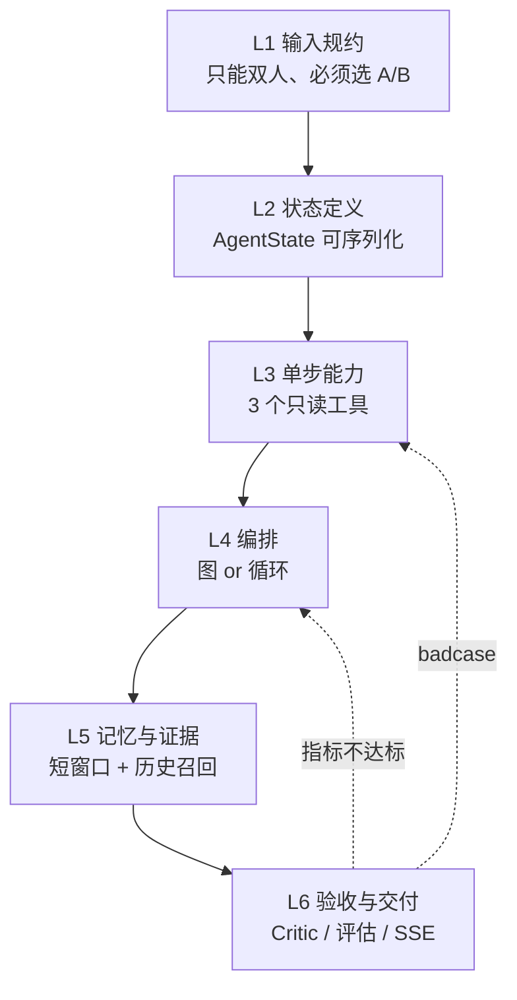

# 面试准备｜Persona Replay（双人聊天语气分身）

> 配套文档：`AI Agent 开源项目源码阅读指南 + Demo 整合方案 + Mermaid 架构图.md`（方案与 15 天计划）
> 本文用途：把「我开发过这个 Agent 项目」在面试里**讲得住、扛得住追问、不撒谎**。
> 撰写依据：`agent_studio_demo/` 实际代码（21 个 Python 文件 / 1544 行 / 12 个单测全绿），非计划稿。

---

## 0. 先定调：这个项目在面试里的真实位置

一句话：**它是一个「自驱学习型 Agent 竖切项目」，卖点不是业务规模，是工程判断力。**

面试官对你的项目只有三种兴趣，按顺序：

1. **你是不是真写过**（能说出文件、报错、取舍、badcase）
2. **你知不知道自己在做什么**（每层能不能说出「为什么这样而不是那样」）
3. **你能不能迁移**（换个场景你还搭得出来吗）

这个项目在 (2) 上天然有优势：它把 Agent 的六层拆得极干净，每层都能讲 trade-off。
在 (1) 上必须靠**细节的真实性**拿下（第 1 节给你弹药）。
在 (3) 上靠第 2 节的方法论收口。

### 三条叙事红线（违反即翻车）

| 不要说 | 改说 |
|---|---|
| "我用了 LangGraph 搭的 Agent" | "我先手写了与 LangGraph 同构的 `StateGraph` 把概念跑通，因为当时环境装不上 langgraph；迁移到官方包只需搬节点函数。"（**这是加分项，不是减分项**，见 §6.2） |
| "做了 15 天完整项目" | "目前打通到 Day6（解析→工具→记忆→状态图→checkpoint），Critic / 评估 / API 是已设计未实现，我能讲清为什么先做这半边。" |
| "效果很好 / 很像那个人" | "现在没有量化结论。评估集和 LLM-as-judge 是下一步，我已经定好了三个指标和 10 轮固定样例。" |

> 心法：**主动交代边界，比被问出来强十倍。** 面试官不怕你没做完，怕你分不清做完和没做完。

---

## 1. 现状盘点（自己心里必须有这本账）

面试前把这张表背下来。左边是「能拿出来演示的」，右边是「只能讲的」。

### 1.1 已实现且可运行

| 模块 | 文件 | 关键事实（可直接说给面试官） |
|---|---|---|
| 聊天解析 | `tools/chat_parser.py` | 支持 `姓名: 内容`、中英冒号、`[2026-10-01 18:30] 姓名: 内容`、`时间 姓名` 换行格式、多行续写；`require_two_speakers()` 硬性拒绝 3 人以上 |
| ReAct 循环 | `agent/react.py` | 手写 Thought→Action→Observation，`max_loops=4`；`parse_action()` 解析 `Final Answer:` 与 `Action/Action Input`；无 API 时用确定性 policy 跑完整循环 |
| 工具层 | `tools/history_tools.py` | 白名单注册表，仅 `parse_chat` / `search_history` / `get_persona`；未注册工具（如 `send_message`）直接 `ValueError` |
| 人设卡 | `memory/persona.py` | `PersonaCard`：句数、平均句长、高频词、常用标点、有无表情、示例回复；`PersonaStore` 可 JSON 落盘 |
| 短期记忆 | `memory/persona.py` | `ShortTermMemory` = `deque(maxlen=6)`，按 thread 保存对话窗口 |
| 历史检索 | `rag/history_index.py` | 词法索引；索引对象是「target 的一条发言 + 紧邻的 user 上文」；打分 = 完全匹配 2.0 + 词重叠率 + 位置微扰 |
| 状态图 | `agent/graph.py` | `StateGraph`(add_node/add_edge/set_entry_point/compile) + `CompiledGraph.invoke(configurable.thread_id)`；强制 thread_id；检测环 |
| 断点续聊 | `memory/checkpoint.py` | SQLite 单表 `checkpoints(thread_id PK, state_json, updated_at)`，UPSERT 全量落盘 |
| 模型接入 | `llm_client/` | `auto/heuristic/deepseek` 三档；DeepSeek 用标准库 `urllib` 直连 `/chat/completions`，401/402 有专门错误文案 |
| 回归测试 | `tests/` | 12 个用例覆盖解析、工具白名单、ReAct 三步、人设卡、记忆窗口、图执行、thread 续聊、缺 thread_id 拒绝执行 |

实测输出（`--provider heuristic`，可直接当面试演示素材）：

```text
persona: {"speaker":"小林","message_count":10,"average_message_length":4.2,
          "common_terms":["哈","王","哥","随","便","呀","嗯","好"],
          "punctuation_style":["，"],"example_replies":["随便呀","嗯嗯都行","哈哈可以"]}
retrieved:
  - score=0.8339: 哈哈知道了        (line 15)
  - score=0.334:  随便，王哥决定     (line 19)
  - score=0.3336: 好的王哥          (line 8)
draft: 随便呀
saved_turns: 1        # 同一 thread 再跑一次变 2，证明续聊生效
```

### 1.2 已设计未实现（讲得清、拿不出来）

Planner 的 LLM 人设抽取（现在是启发式）、Critic 节点、条件重写边、`interrupt` HITL、embedding 向量检索、FastAPI + SSE、10 轮评估器、Dockerfile、mem0 适配器、Pydantic 校验（现在用 dataclass）。

### 1.3 四个"设计债"（**面试深挖时主动抛出，威力最大**）

面试官最爱问"你现在回头看有什么问题"。答这四条，比答"代码写得不够优雅"强 100 倍：

1. **当前调度器禁止回边。** `CompiledGraph.invoke` 用 `visited` 集合，同一节点访问两次就 `raise RuntimeError("graph cycle detected")`。所以我现在**还不能加 Critic→draft 的重写循环**——一加就炸。正确做法是把 `visited` 换成 `max_steps` 预算（步数上限 + 超限降级为"追问/拒答"），这是加 Critic 之前必须先改的。
2. **每轮重复建索引。** `_retrieve_node` 每轮重新 `parse_chat_file` + 重建 `HistoryIndex` + 重算 `PersonaCard`。O(n) 全量扫描，样例 20 条无所谓，1 万条聊天记录就是每轮秒级延迟。应把索引挂在 session 级（首次导入建一次）。
3. **checkpoint 会把用户原话明文落盘。** `state_json` 里有 `user_input` 全文。用合成数据没事，接真实私聊就是隐私事故。生产化要改成「落盘前脱敏 + 只存摘要」或加密列。
4. **检索只有字面重叠。** 中文按单字切，`晚饭` 和 `吃饭` 召不回来（实测 top1 score 0.8339 就是这么来的，没到 1.0 阈值）。这是"为什么必须上 embedding 或至少 bigram + 同义词"的最直接证据。

---

## 2. Agent 是怎么搭起来的：六层递进（这是你的方法论资产）

把项目讲成"能力分层"，而不是"我写了几个文件"。下面每层给：**本项目的实现 → 通用原理 → 面试考点**。



### L1 输入规约：先把"不可能"挡在门外

- 本项目：`require_two_speakers()` 直接拒绝群聊；`user_speaker != target_speaker`；说话人必须来自解析结果。
- 原理：Agent 项目 80% 的玄学问题来自**输入没有规约**。群聊 speaker 归属噪声大，做不稳；不如显式拒绝。
- 面试考点：**"你的系统在什么情况下会拒绝服务？"** 能答出输入校验边界的人，通常真上过线。

### L2 状态定义：State 决定架构

- 本项目：`AgentState` 11 个字段（`thread_id / speakers / persona / retrieved / draft / reply / short_memory / steps / turn_count ...`），全部可 JSON 序列化，因为要进 SQLite。
- 原理：**图编排的本质是"共享状态 + 转移函数"**。State 里放什么，决定节点之间怎么解耦；State 可序列化，才谈得上 checkpoint、回放、debug。
- 面试考点：**"你的 Agent 状态里有什么？为什么这些字段？"** 答"能落盘、能回放、能只传增量"就到位了。

### L3 单步能力：工具白名单 = 能力边界

- 本项目：三个只读工具，输入输出统一 JSON 字符串（而不是 Python 对象）——因为模型只会输出文本，`Action Input` 必须是可解析的字符串。
- 原理：**工具是 Agent 唯一能产生副作用的出口**。白名单不仅是安全，也是可控性：工具越少，ReAct 越不容易乱走。
- 面试考点：**"怎么防止 Agent 乱调工具 / 提示词注入让它调用危险工具？"**
  标准答案骨架：① 白名单 + 未注册即抛错；② 工具只读、不触达外网/写库；③ 参数 schema 校验（本项目 `_payload()` 强制 JSON object）；④ 敏感动作走人工确认（HITL）；⑤ 输入里的"指令"永远当数据，不当指令（分隔符 + 明确声明）。

### L4 编排：ReAct 循环 vs 状态图（**最高频对比题**）

| 维度 | ReAct 循环（`agent/react.py`） | 状态图（`agent/graph.py`） |
|---|---|---|
| 控制流 | 模型决定下一步，动态、不可预知 | 开发者定义拓扑，模型只在节点内自由 |
| 可测性 | 差（依赖模型输出格式） | 好（节点是纯函数，可单测） |
| 可恢复 | 难（循环中间态没定义） | 易（每步落 checkpoint） |
| 适合 | 探索型、工具多、路径不定 | 业务型、路径固定、要审计/人工介入 |
| 本项目结论 | 用它理解原理 + 做检索取证 | **主运行时用它**，因为要 Critic 重写、HITL、续聊 |

- 面试考点：**"为什么主运行时用图不用 ReAct？"**
  答："这个场景的路径是固定的（检索→起草→审→回），模型的自由度应该收在「起草」这一个节点里；ReAct 把控制权交给模型，换来的灵活性我不需要，却要付出不可测、不可恢复的代价。"

### L5 记忆与证据：RAG 在这里不是知识库

- 本项目：短期 = 6 轮窗口；长期 = 人设卡；检索 = 「target 发言 + 上文」成对入索引。
- 关键认知（**说这句会显得很懂**）：**"这里的 RAG 不是为了注入知识，是为了注入证据。"** 召回的句子会原样进 prompt，也会原样吐给用户（SSE 的 `retrieved` 事件），用来证明"不是纯 prompt 装腔"。
- 切片决策：**按「一条发言」切，不按 500 字 chunk 切**。因为两个人的话揉进一个 chunk，检索命中了也分不清是谁的语气，人设会串台。
- 面试考点：**"为什么不用固定长度 chunk？"** → 上面这句，再补"聊天记录天然有 speaker 边界，切分应该尊重语义边界而不是字数边界"。

### L6 验收：把"像不像"变成可判定的门

- 本项目现状：**没有 Critic，没有评估集**。这是最大缺口，也是最好的"我知道下一步做什么"的证明。
- 设计（要能画出来）：Critic 输出结构化判定 `{语气像不像, 是否串台, 是否编造}`；不通过 → 条件边回 draft（**前提是先修 §1.3 第 1 条**）；敏感（钱/地址/健康/账号）→ `interrupt` 暂停等人。
- 原理：**Agent 项目的成熟度不看功能数，看"能不能自动判定自己错了"。**
- 面试考点：**"你怎么知道它变好了？"** —— 见 §5 评估组。

---

## 3. 三档自我介绍（逐字稿，按面试时长选）

### 30 秒版（一面开场、HR 面）

> 我做过一个 Agent 的竖切项目，叫 Persona Replay：导入一份双人聊天记录，指定"我是谁、AI 扮谁"，系统检索对方历史上怎么回过类似的话，再按人设卡（称呼、句长、口头禅）生成回复，最后由 Critic 拦住助手腔和编造。
> 技术上是 Python + 状态图编排 + 只读工具 + 分层记忆 + SQLite checkpoint，12 个单测覆盖了从解析到续聊的边界。我做得最深的是**可解释**：每轮回复都能打出召回了哪条历史原句、凭什么这么回。

### 2 分钟版（技术面）

> 这个项目起因是想搞清楚 Agent 到底由哪几层构成，所以我故意把场景收窄成一个必须"检索在前、生成在后"的任务——模仿一个人说话。
> 分六层做：第一层输入规约，只支持双人、必须选 A/B，群聊直接拒绝；第二层 State 定义，所有字段可序列化，因为要落 SQLite 做 checkpoint；第三层工具，只有三个只读工具，白名单外一律抛错，保证 Agent 没有外发能力；第四层编排，我先用 ReAct 循环跑通"解析→检索→读人设→作答"，理解了模型驱动的不确定性之后，把主运行时换成状态图，因为路径固定、还要支持人工介入；第五层记忆和证据，短期是 6 轮窗口，长期是人设卡，检索索引的对象是"对方的一条发言 + 我问的上文"；第六层是验收，目前做到 CLI + 测试，Critic 和评估集是下一步。
> 现在能演示：一条命令跑完一轮，输出人设卡、召回的 3 条历史原句和分数、生成的回复；同一 thread_id 再跑一次，`saved_turns` 从 1 变 2，证明续聊生效。
> 我最想讲的两个坑：调度器用 visited 去重导致加不了 Critic 回边；以及 checkpoint 会把用户原话明文落盘，接真实数据前必须脱敏。

### 10 分钟版（深聊，按 §2 六层讲）

顺序：场景约束 → State → 工具白名单 → ReAct/图对比 → RAG 切片决策 → checkpoint → 下一步（Critic + 评估 + SSE）。**每层只讲一个"我做的决定 + 为什么不是另一个"**，不要平铺功能。

---

## 4. 简历怎么写（3 条，每条都可被追问）

```text
Persona Replay｜双人聊天语气分身 Agent（个人项目，Python）
· 以「检索在前、生成在后」为约束设计 6 层竖切架构：输入规约 → 可序列化 State →
  只读工具白名单 → 状态图编排 → 分层记忆 → SQLite checkpoint；12 个单测覆盖
  解析边界、工具越权、图执行与 thread 续聊。
· 手写与 LangGraph 同构的 StateGraph（node/edge/compile/invoke + configurable.thread_id），
  在无外部框架依赖下跑通 retrieve→draft 主链路，节点函数可原样迁移到官方 API。
· 设计"证据可解释"链路：按「一条发言 + 上文」建历史索引，每轮将召回的 top-3 原句
  与打分随回复一并输出，避免纯 prompt 模仿；支持 DeepSeek / 离线启发式双 provider。
```

**反例（别这么写）**："基于 LangGraph 构建多智能体协同系统，实现 RAG、Memory、HITL 全链路"——一个词一个追问，全对不上。

数字口径（都能自证）：**12 个单测全绿、3 个工具、2 个节点、21 个 py 文件**。别写行数，行数不涨分。

---

## 5. 高频追问 40 问：回答骨架

> 不是背稿，是背"结构"。每题给：**核心答案 + 可展开点 + 陷阱**。

### A. 动机与选型

**A1 为什么做这个场景？**
想找一个人人秒懂、又必须"先检索后生成"的任务。写周报、做客服都能糊过去（纯 prompt 就够），模仿语气糊不过去——不引用历史就必然露馅。**陷阱**：别说"因为好玩"。

**A2 为什么不用现成框架一把梭？**
框架解决的是"拼装"，不解决"判定对不对"。而且我想先搞清 State/Edge/Checkpoint 到底在做什么，直接上框架会变成调 API。**可展开**：手写一遍后，再看官方 Pregel 调度才知道差异在哪（见 §6.2）。

**A3 为什么 Python？**
生态（LLM SDK、向量库、评测）。这个项目瓶颈在迭代速度不在吞吐。

**A4 为什么只支持双人？**
说话人归属是这类系统的噪声源。三个人以上，"这句到底像谁"就变成聚类问题了，15 天内做不稳。**主动拒绝比勉强支持更专业。**

### B. 架构与状态

**B1 画出你的架构。**（画 §2 的六层 + 数据流：上传 → 解析 → 建索引 → 人设 → 用户输入 → 召回 → 起草 → Critic → 出口）

**B2 State 里为什么有 `steps`？**
可观测性。`steps: ["retrieve","draft"]` 是最便宜的 trace，出问题一眼看出卡在哪一步。**展开**：生产化会换成结构化 span（每步耗时、token、工具入参出参）。

**B3 大 State 全量落盘的问题？**
写放大 + 隐私风险 + 无法做增量恢复。理想是 event-sourced：只存每个节点的写入，恢复时重放。

**B4 为什么 thread_id 是必填、缺了就报错？**
因为"没有会话身份的 Agent"无法续聊、无法审计、无法限流。宁可启动失败也不要静默新建会话——**静默兜底是线上事故的常见形态**。

**B5 图里有环会怎样？**（→ 直接抛出 §1.3 第 1 条，这是你的高光时刻）

### C. ReAct 与工具

**C1 你的 ReAct 和论文里的差在哪？**
差在"谁决定下一步"。论文是模型输出 Thought/Action；我这边为了无 API 也能跑，默认 policy 是确定性的（固定 parse→search→persona 顺序），模型接入后只替换 policy，循环骨架不变。**这是刻意的可测试性设计**。

**C2 怎么处理模型输出格式错？**
`parse_action` 找不到 `Final Answer` 也不匹配 `Action/Action Input` 就抛 `ValueError`，由上层决定重试还是降级。生产上应该：① 用 JSON schema/function calling 约束；② 失败重试 + 修复提示；③ 两次失败降级为直接回答。

**C3 工具为什么返回 JSON 字符串而不是对象？**
模型只能看到文本，返回值最终要进 prompt；统一成 JSON 字符串，解析逻辑只有一处（`_payload()`），也方便日志。

**C4 工具参数被注入怎么办？**
参数只走 JSON schema 校验；路径类参数做白名单/沙箱；永远不把工具返回值当指令执行（二次注入）。

**C5 工具越多越好吗？**
不是。工具数↑ → 选择空间↑ → 误调用↑、prompt 变长。宁可做少而正交的工具。

### D. RAG

**D1 为什么按"一条发言"切？**（→ §2 L5）

**D2 你的检索是词法还是向量？**
现状是词法（中文按单字集重叠 + 完全匹配加权）。**坦白 + 给出证据**：实测 `王哥今晚加班，晚饭你自己先吃？` 的 top1 是 `哈哈知道了`，score 0.8339，正好说明字面匹配在"语义相近但用词不同"时不可靠。下一步换 embedding 并用同一批 query 做 A/B。

**D3 怎么评估检索质量？**
Hit@3 + MRR，用 30 条人工标注的「这句话最应该召回哪条历史」做小样本评测。**埋点**：即使现在不做，也要说得出指标名。

**D4 向量库选型？**
Qdrant（过滤条件强、支持 payload filter）vs Chroma（轻、上手快）。这个规模选 Chroma 就够；真实场景要按 speaker 过滤，Qdrant 更顺手。**陷阱**：别说"因为流行"。

**D5 召回不相关时怎么办？**
① 阈值过滤（score 低于阈值就当没检索到）；② prompt 里显式写"无依据时用含糊短句或说记录里没提过"；③ 这一点已在 `deepseek.py` 的 user prompt 里实现。

### E. 记忆

**E1 短期和长期怎么分工？**
短期 = 本场对话 6 轮窗口（保称呼和当前话题）；长期 = 人设卡 + 稳定事实（"叫你王哥""几乎不用句号"）。**判据**：跨会话还有用 → 长期；只对本场有用 → 短期。

**E2 为什么窗口是 6 轮？**
成本和"跑题"的平衡点，可配。**展开**：超过窗口的部分做摘要压缩（roll-up），而不是直接丢；这是下一步。

**E3 人设卡为什么用启发式不用 LLM？**
先让数据跑通、可解释、零成本、可单测。LLM 抽取的收益是"称呼、关系、语气词"这类语义信息，成本是不稳定 + 要花钱。**接口没变**（`build_persona_card` 换实现即可），所以这不是欠债，是分层。

**E4 mem0 为什么没接？**
它的价值在"多会话事实抽取 + 去重 + 更新"，我这个场景的事实量很小（人设几条），先自研够了。接了反而多一个不确定性来源。**这句能体现"不为了用而用"**。

### F. Critic 与幻觉

**F1 怎么防编造记录里没有的事？**
三层：① 检索无依据就在 prompt 里禁止编造（已实现）；② Critic 结构化判定"回复中的事实断言是否都能在召回证据里找到"（待实现）；③ 涉及钱/地址/健康/账号直接 `interrupt` 转人工（待实现）。

**F2 Critic 用什么判？LLM-as-judge 靠谱吗？**
三个二元维度：像不像（句长/口头禅/标点是否落在人设范围）、串不串台（是否用了另一个人的口吻）、有没有编（事实断言 vs 证据）。**靠谱程度取决于 rubric 是否可判定**——所以拆成二元判断，而不是让模型打 1-10 分。

**F3 Critic 自己也会错，怎么办？**
① 二元 + 明确 rubric，降低方差；② 固定样例回归，改 prompt 必须过评估集；③ Critic 只做"拦截"，最终裁决权在人（HITL）；④ 误杀（把好回复拦掉）比漏放更伤体验，所以阈值偏松 + 允许一次重写后放行。

**F4 重写循环会不会死循环？**
会。所以必须有步数预算（`max_steps`），超限就降级：追问一句 或 输出最保守的短句。**这正是当前调度器要改的地方**（§1.3-1）。

### G. HITL

**G1 什么情况暂停？**
Critic 不通过两次 / 命中敏感类目（钱、地址、健康、账号、承诺）/ 用户显式要求确认。

**G2 怎么实现暂停和恢复？**
LangGraph 的 `interrupt()` + checkpointer：暂停时把待写入状态存下来，恢复时带同一个 `thread_id` 继续。**我现在的实现是手写 checkpointer，还没有 interrupt 语义**——要如实说，并说清"差别在于 pending writes 的保存"。

**G3 暂停期间用户改了内容，怎么合并？**
以人工输入为准写回 state 的 `reply` 字段，然后跳过 Critic 直接出口（人工已裁决），但保留 `critique` 原文用于审计。

### H. 评估（**最容易被问倒的一组**）

**H1 你怎么衡量"像不像"？**
三层：① 客观统计（平均句长、标点分布、口头禅命中率——可自动化、和真实分布比 KL/差值）；② LLM judge 二元判定；③ 人工盲测（10 轮，A/B 两版回复混排让人猜哪个是真人）。**关键句**：客观指标先立起来，因为便宜、稳定、能进 CI。

**H2 现在有数字吗？**
没有端到端指标。有的是：12 个单测、检索 top-3 的样例输出、人设卡统计（平均句长 4.2 字）。**别编数字，编了必被追问细节**。

**H3 怎么防"过拟合到黄金样例"？**
留出集。`fixtures` 里 20 条用于开发，另外合成/授权一批不参与调参的记录做验证；评估集版本化，改 prompt 前后跑同一套。

**H4 评估集多大合适？**
先 10 轮固定对白（覆盖：普通寒暄、提问、拒绝、敏感、记录里没有的事）。**小样本 + 高覆盖 > 大样本 + 随机**。

### I. 服务化

**I1 SSE 推哪些事件？**
`persona`（人设卡，开场一次性）→ `retrieved`（证据，让用户看到依据）→ `draft`（可选，调试用）→ `critique`（判定，可选）→ `reply_delta`（流式正文）→ `interrupt`（需人工）→ `done`。

**I2 为什么不用 WebSocket？**
单向推送 + 断线重连用 `Last-Event-ID` 就够；SSE 走 HTTP、过网关友好、实现成本低。双向需求（中途插话）再上 WS。

**I3 并发和限流？**
按 thread_id 串行（同一会话不能并发写 state），跨会话并行；单用户 QPS 限流 + LLM 调用超时/重试/熔断。**这一点现在没做，要承认**。

**I4 长任务怎么办？**
导入大文件（10 万条）不能同步做：改成任务队列（后台建索引）+ 前端轮询/推送进度。

### J. 成本与性能

**J1 一轮多少 token / 多少钱？**
估算口径：system（人设 ~200 token）+ 证据 3 条 + 记忆 6 轮 + 用户输入。**说得出"我怎么算的"比说得出具体数字更重要**。

**J2 延迟瓶颈在哪？**
现状：同步 HTTP 调模型 + 每轮重建索引（§1.3-2）。优化顺序：索引缓存 → 流式输出（首 token 体感）→ 证据裁剪（top-3 → top-2）。

**J3 怎么降本？**
小模型做人设抽取和 Critic（判定任务不需要强模型）、检索结果去重、缓存人设卡（每 thread 只算一次）。

### K. 安全与伦理（**这个场景必问**）

**K1 这个项目是不是"冒充别人"的工具？**
**主动划界**：定位是"个人学习 / 已获同意的记录实验"；产品层面禁用于冒充、诈骗、公开传播；仓库只放合成样例；真实记录本地跑、优先本地模型；涉及钱款地址等直接拒绝或转人工。**态度要明确，不要含糊**。

**K2 数据怎么保护？**
现状：合成数据、真实记录 gitignore、不打印全文。**已知风险**：checkpoint 明文落盘（§1.3-3），接真实数据前必须脱敏/加密。

**K3 如果对方不知情呢？**
不做。这不是技术问题是伦理问题，产品上就不该开这个口子。

### L. 工程与测试

**L1 12 个测试都测了什么？**（→ §1.1 表格最后一行，能报出用例名最好）

**L2 怎么测"依赖模型"的部分？**
把模型抽成 `ReplyModel` Protocol，测试里注入确定性的 `HeuristicReplyModel`。**这就是依赖注入在 Agent 项目里的用法**：模型是不可靠外部依赖，必须可替换。

**L3 怎么调试"回答不对"？**
先看 `steps` 定位阶段 → 看 `retrieved` 是检索错还是生成错 → 检索错调索引/阈值，生成错调 prompt/人设 → 都不是就是 Critic/评估缺失。**这个排查树是加分项**。

### M. 反思

**M1 最大的失败/返工？**
两点：① 一开始想用 ReAct 当主运行时，写到 Critic 重写时发现循环中间态没法定点恢复，推倒换图；② 检索一开始想按段落切，实测发现两人的话被揉在一起、召回后分不清谁说的，改成按发言条切。**说返工，不说"没什么困难"**。

**M2 如果重做？**
先定评估集再写代码。现在我是"先跑通再想怎么量"，顺序反了——评估集应该是第一行代码。

**M3 这个项目能迁移到什么场景？**
任何"必须先取证再生成"的场景：客服（先查订单再答）、代码助手（先读仓库再改）、合规问答（先查条款）。**共同点：证据可展示 + 生成必须受证据约束。**

---

## 6. 五个必翻车问题 & 标准处理

### 6.1 "这不就是套壳 prompt 吗？"

**不要防守，直接给三个反证：**
1. 证据链：每轮输出召回的历史原句和分数，关掉检索会退化（这是可演示的对照）。
2. 判定链：Critic 是独立于生成的结构化判定，不是同一段 prompt 里的"请检查一下"。
3. 状态链：checkpoint + thread_id 让同一会话可续、可回放、可审计——套壳 prompt 没有状态机。

### 6.2 "你说用了 LangGraph，代码在哪？"（**shim 问题**）

这是最容易当场社死的一问。**标准答法（诚实 + 反打）：**

> 主链路现在跑的是我手写的同构实现：`StateGraph` + `add_node/add_edge/set_entry_point/compile` + `invoke(config={"configurable":{"thread_id":...}})`，checkpointer 是 SQLite。当时环境装不上 langgraph，我不想因为装包卡住学习，就先把概念用 100 多行实现了一遍——节点函数签名完全按官方 API 设计，迁移只换壳。
> 反倒因此看清了差异：官方是 Pregel 的 BSP 超步调度，同一步内的节点并行、用 channel 做更新归约（所以有 reducer）；我只做了单线程串行、每节点全量 dump state。官方 checkpoint 每个超步写一次并记录 pending writes，所以 `interrupt` 能精确恢复；我的只能整份 state 覆盖。**这也是我下一步要迁移的原因。**

（这段说完，面试官通常会把"你是不是抄的"改成"那你什么时候迁"。）

### 6.3 "效果怎么衡量？有数字吗？"

> 端到端还没有。有的是：12 个单测、检索 top-3 的实测样例、人设卡统计（平均句长 4.2 字、高频词 哈/王/哥/随便/呀）。评估集我已经定好设计——10 轮固定对白 × 三个二元指标（像不像 / 串不串台 / 有没有编），客观统计先上，LLM judge 后上。**没有数字我就不说好。**

### 6.4 "AI 帮你写的吧？"

（仓库里有 AI 助手配置和大量结构化文档，被问到的概率不低。）

> 文档和样板代码我大量用 AI 加速，这是现在正常的开发方式。但**架构取舍、状态字段、白名单边界、这几个坑（visited 去重、明文落盘、字面检索）都是我自己踩出来的**。你可以现在挑一个文件让我讲，或者让我现场加一个工具/改一个节点。

**唯一解法：真的能现场改。** 面试前把 `traces` 过一遍，确保任何一个文件都能讲 3 分钟。

### 6.5 "这个场景没商业价值 / 伦理有问题？"

> 它本来就不是商业项目，是我用来吃透 Agent 六层的训练场。价值在于：这套骨架换个场景能直接复用（客服取证、代码助手、合规问答）。伦理上我划了线：合成数据、本地优先、禁止冒充、敏感内容转人工。

---

## 7. 面试前补强清单（按 ROI 排序，**含明确不做**）

> 原则：**先补"会被追问到答不上来"的，再补"好看的"。**

| 优先级 | 动作 | 为什么（面试官会问什么） | 工时 | 交付物 |
|---|---|---|---|---|
| **P0** | 把 `visited` 环检测改成 `max_steps` 预算 | "加 Critic 重写你怎么防死循环？" | 0.5d | 调度器改动 + 1 个测试 |
| **P0** | 加 Critic 节点 + 条件边 | "怎么保证不像就重写？"（这是项目宣称的核心） | 1d | `agent/nodes.py` + rubric prompt + 测试 |
| **P0** | 10 轮评估器 + 客观指标 | "有数字吗？"（最常翻车） | 1d | `evaluator/llm_judge.py` + 一次跑分报告 |
| **P0** | 最小 FastAPI + SSE | "怎么给前端用？" | 1d | `/chats/import`、`/sessions`、`/sessions/{id}/stream` |
| **P1** | 迁移到官方 LangGraph（或把 shim 写成显式设计说明） | "代码在哪？" | 1d | 图定义迁移 + README 说明 |
| **P1** | 加 embedding 检索，和词法做 A/B | "为什么召回不准？" | 1d | 对比表（同一批 query 的 Hit@3） |
| **P1** | checkpoint 落盘脱敏 | "真实数据怎么办？" | 0.5d | 脱敏函数 + 说明 |
| **P2** | Dockerfile | "能跑起来吗？" | 0.5d | 一键启动 |
| **P2** | 一次 badcase 复盘日志 | "举个例子" | 0.5d | 文档 1 页 |
| **不做** | React 前端、多智能体框架堆砌、K8s、LangSmith 全埋点 | 性价比低，且会稀释"单场景做深"的叙事 | — | — |

> 时间不够时的取舍：**P0 的四个里，至少做完「Critic + 评估」**。因为项目名字里的"语气分身"和"不编造"，全靠这两个来自证；只做检索+生成，面试官会说"这就是个 RAG demo"。

---

## 8. 现场演示方案（5 分钟，含兜底）

```powershell
cd D:\code_2026\AI_Agent\agent_studio_demo

# 1) 12 个测试全绿（30 秒，建立可信度）
python -m unittest discover -s tests -t . -p "test_*.py" -v

# 2) 一轮完整扮演（离线，必定成功）
python -m agent.demo --provider heuristic `
  --message "王哥今晚加班，晚饭你自己先吃？" `
  --thread-id demo-thread --checkpoint runtime\demo.sqlite3 --show-react

# 3) 同一 thread 再跑一次，证明续聊（saved_turns: 1 -> 2）
python -m agent.demo --provider heuristic --message "那周六呢？" `
  --thread-id demo-thread --checkpoint runtime\demo.sqlite3

# 4) 有 Key 时切真模型做对照（说明"同一份证据，换模型换语气"）
python -m agent.demo --provider deepseek --message "王哥今晚加班，晚饭你自己先吃？" `
  --thread-id demo-thread
```

**讲解脚本（照着说）：**
1. 先跑测试 —— "边界先钉死，工具越权、三人群聊、缺 thread_id 都会失败"。
2. 跑第 2 步 —— 指 `persona`（4.2 字、常用词）、指 `retrieved`（score 0.8339 的那条）、指 `draft`。强调：**"回复是从证据里来的，不是从 prompt 里来的。"**
3. 跑第 3 步 —— 指 `saved_turns: 2`。强调：**"会话身份是 thread_id，不是说话人。"**
4. 主动说 heuristic 的性质 —— "这是离线兜底模型，作用是让整条链路无网络可验证；它不是 LLM，演示真模型我会切 deepseek。"（**先说，别等被问**）
5. 收尾 —— 打开 §1.3 讲四个坑，把"我知道哪里不行"变成优势。

**兜底**：网络/额度挂了就用 heuristic；被要求看代码就从 `agent/graph.py` 的 `invoke()` 讲 10 行，再跳到 `tools/history_tools.py` 的白名单。

---

## 9. 一页速查卡（面试前 10 分钟看）

```text
项目：Persona Replay｜双人聊天语气分身
一句话：检索在前、生成在后、审完再回；证据必须能打出来。

六层：输入规约 → State → 只读工具 → 图编排 → 记忆/证据 → 验收交付
现状：Day1–6 通；Critic/评估/API 未做（能讲清设计）
数字：12 单测 / 3 工具 / 2 节点 / 21 py 文件 / 人设平均句长 4.2

三个"我做的决定"：
1. 主运行时用图不用 ReAct —— 路径固定、要审计和人工介入
2. 按"一条发言+上文"切索引 —— 尊重 speaker 边界，避免串台
3. 模型抽成 Protocol，测试注入确定性实现 —— 模型是不可靠外部依赖

四个"坑"（主动抛）：
1. visited 去重 → 加不了 Critic 回边，要改 max_steps 预算
2. 每轮重建索引 → 大文件下 O(n) 延迟
3. checkpoint 明文落盘 → 接真实数据前必须脱敏
4. 只有字面检索 → "晚饭/吃饭"召不回，要 embedding

三条红线：不说"用了 LangGraph"（说"同构实现+待迁移"）；
         不说"完整 15 天"（说 Day1–6 + 设计）；
         不给没有的数字。

收尾金句：
"这个项目对我最大的价值不是跑通了什么，而是我知道了它哪里会崩、
 以及下一步先修哪个。"
```

---

## 10. 话术禁区

| 禁区 | 原因 |
|---|---|
| "我用了 LangGraph / LangChain 构建" | 代码里不是，一问就露 |
| "多智能体协同" | 只有单图三节点（且 Critic 未实现），会被追问到崩溃 |
| "上线 / 有用户 / 提升 X%" | 没有，编了就是诚信问题 |
| "效果很好，很像" | 没有评估支撑 |
| 背"架构分层"却不讲取舍 | 面试官要的是判断，不是目录 |
| 被问不会的答"这个我们内部有方案" | 个人项目没有"内部"，直接说"没做到，我会这样补" |

---

> 最后一句：**面试考察的不是"你做完了一个 Agent"，而是"你现在能不能独立搭起下一个"。**
> 这个项目已经证明你能拆层、能写测试、能发现自己代码的边界；把 §1.3 那四个坑讲透，比再多做三个功能都值钱。
